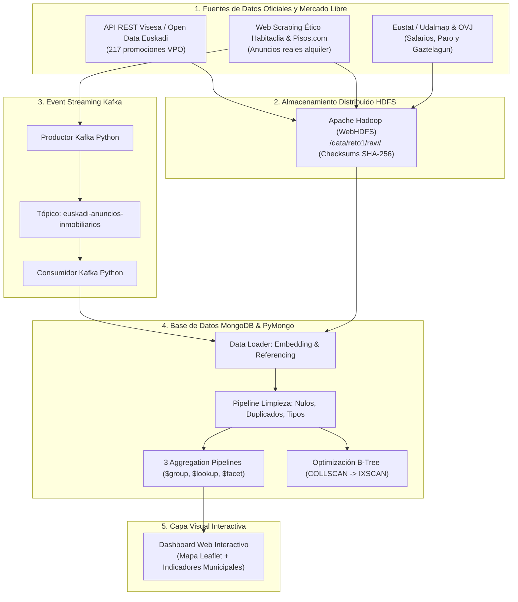

# ¿Dónde pueden vivir los jóvenes en Euskadi? · Reto Intermodular BDA + SBD

Sistema de recopilación masiva, ingesta distribuida, procesamiento en streaming y análisis documental en MongoDB para responder a la pregunta de la administración pública: **¿Puede una persona joven independizarse en Euskadi con su salario?**

El análisis con datos reales demuestra que un joven asalariado medio en Euskadi (1.380 € netos/mes) destina el **61,6 %** de su sueldo al alquiler en el mercado libre en solitario (superando con creces el límite de riesgo del 30 %). **Con la ayuda del programa Gaztelagun (hasta 300 €/mes), la tasa de esfuerzo desciende al 39,8 %**, haciendo viable la emancipación en Vitoria-Gasteiz y municipios de la periferia metropolitana, mientras Donostia y Bilbao centro continúan en situación de severa tensión inmobiliaria.

**Herramientas:** Python · PyMongo · MongoDB · Apache Hadoop (HDFS / WebHDFS) · Apache Kafka · Requests (REST API) · BeautifulSoup4 · Pydantic · pytest · HTML5/Leaflet

---

## 1. El problema de negocio

El acceso a la vivienda es el obstáculo central para la emancipación juvenil en la Comunidad Autónoma del País Vasco. El encarecimiento sostenido del alquiler residencial y la escasez de parque público generan una brecha insalvable entre los salarios iniciales de la juventud (18 a 34 años) y las rentas de mercado.

**Objetivo:** Desarrollar una solución tecnológica integral de Big Data que extraiga datos del mercado inmobiliario, ingeste estadísticas oficiales salariales y sociodemográficas, almacene los datos en un cluster distribuido (HDFS), simule eventos de anuncios en tiempo real (Kafka) y realice el modelado, limpieza, consultas y agregaciones estadísticas avanzadas en MongoDB para fundamentar decisiones de política pública de vivienda.

| Dimensión | Especificación del Proyecto |
|---|---|
| **Tipo de Problema** | Ingesta masiva, Data Lakehouse distribuido, streaming y analítica documental NoSQL |
| **Destinatario / Quién lo usa** | Departamento de Planificación Territorial, Vivienda y Transportes del Gobierno Vasco y observatorios de juventud |
| **Caso análogo en la industria** | Portales inmobiliarios y servicios autonómicos de vivienda que monitorizan zonas de mercado residencial tensionado (ZMT) según la Ley de Vivienda |

---

## 2. Qué hemos construido y Arquitectura del Sistema



### Recorrido de los datos:
1. **Extracción (BDA)**: Extracción periódica mediante API REST de promociones de vivienda protegida y scraping ético de anuncios de alquiler residencial, respetando políticas de `robots.txt`, cabeceras y límites de tasa.
2. **Almacenamiento Distribuido (BDA)**: Los ficheros originales se preservan inmutables en Hadoop HDFS con estructura jerárquica de particiones temporales (`/data/reto1/raw/vivienda/api/`, `/data/reto1/raw/vivienda/scraping/`, `/data/reto1/raw/indicadores/`) y verificación de checksums SHA-256.
3. **Simulación en Tiempo Real (BDA)**: El productor Kafka publica eventos validados con Pydantic hacia el tópico `euskadi-anuncios-inmobiliarios`, donde el consumidor procesa la llegada continua de ofertas.
4. **Almacenamiento y Analítica NoSQL (SBD)**: Los datos se integran en MongoDB a través de PyMongo, aplicando transformaciones de calidad de datos, índices compuestos, consultas complejas y pipelines de agregación.
5. **Capa Visual**: Visualización geoespacial interactiva mediante dashboard web en HTML5/Leaflet con selector de municipios, capas de esfuerzo y gráficos comparativos.

---

## 3. Fuentes de Datos y Esquema

| Fuente | Tipo | Origen de los Datos | Campos Principales | Calidad y Tratamiento |
|---|---|---|---|---|
| **Visesa / Open Data** | API REST JSON | Open Data Euskadi / Dpto. Vivienda | `id`, `titulo`, `municipio`, `tipo_operacion`, `precio`, `superficie_m2` | Datos oficiales estructurados; se normalizan tipos y se clasifican como VPO |
| **Habitaclia & Pisos.com** | Web Scraping | Portales inmobiliarios en Euskadi | `titulo`, `precio_mes`, `municipio`, `superficie`, `caracteristicas` | Precios en bruto convertidos a float; deduplicación por ID de anuncio |
| **Udalmap / Eustat** | API REST JSON | Eustat / Instituto Vasco de Estadística | `municipio`, `renta_media_personal`, `salario_joven`, `paro_juvenil_pct` | Se imputan medias comarcales en valores ausentes |
| **OVJ (Juventud)** | Informes y Datos OVJ | Observatorio Vasco de la Juventud | `tasa_esfuerzo_media`, `cobertura_gaztelagun_max` | Datos de referencia para contraste de viabilidad (umbral máx. 30 %) |

---

## 4. Implementación y Rúbrica de SBD (Sistemas Big Data)

### A. Modelado Documental (Embedding vs. Referencing)
- **Colección `municipios` (Embedding)**: Incrusta los indicadores socioeconómicos oficiales, población y el array de programas de subvención juvenil (`programas_ayuda: [{nombre: 'Gaztelagun', cobertura_max: 300}]`). Decisión técnica: los datos del municipio se consultan de forma atómica y conjunta, eliminando la sobrecarga de joins relacionales para lecturas de cuadro de mando.
- **Colección `viviendas` (Referencing)**: Contiene los inmuebles con referencia al nombre del municipio (`municipio: "Bilbao"`). Decisión técnica: permite escalar horizontalmente millones de anuncios de forma independiente sin superar el límite de 16 MB por documento de BSON.

### B. Limpieza y Transformación Automatizada (`src/database/cleaning.py`)
El pipeline automatizado en Python ejecuta 4 operaciones clave sin intervención manual:
1. **Eliminación de duplicados**: Deduplicación por `id_origen` conservando la versión más reciente.
2. **Tratamiento de nulos/ausentes**: Imputación de superficies mínimas y generación de subdocumentos de características por defecto.
3. **Estandarización de tipos**: Casteo de cadenas numéricas a punto flotante de alta precisión (`float`).
4. **Cálculo de campos derivados**: Cálculo directo de `precio_m2 = round(precio / superficie_m2, 2)` y clasificación categórica del nivel de accesibilidad (`MUY_ACCESIBLE`, `ACCESIBLE_CON_GAZTELAGUN`, `TENSIONADO_EXCLUSIVO`).

### C. Consultas Analíticas Avanzadas (`src/database/queries.py`)
Se implementaron y probaron 5 consultas especializadas:
- **Consulta 1**: Filtro de igualdad por municipio y ordenación por precio (`find({"municipio": "Bilbao", "tipo_operacion": "alquiler"}).sort("precio", 1)`).
- **Consulta 2**: Filtro de rango numérico con operadores de comparación (`{"precio": {"$gt": 0, "$lte": 750}}`).
- **Consulta 3**: Multifiltro con operador lógico `$and` combinando municipio, precio y superficie mínima.
- **Consulta 4**: Consulta sobre subdocumentos estructurados anidados (`{"caracteristicas.habitaciones": {"$gte": 2}, "caracteristicas.ascensor": True}`).
- **Consulta 5**: Consulta sobre arrays embebidos utilizando `$elemMatch` para detectar municipios con el programa `Gaztelagun`.

### D. Aggregation Pipelines (`src/database/aggregations.py`)
Se implementaron 3 pipelines con más de 5 etapas diferentes:
1. **Pipeline 1 (`$group` municipal)**: `$match` -> `$group` -> `$project` -> `$sort`. Calcula precio medio, mínimo, máximo, superficie y precio/m2 agrupado por cada municipio.
2. **Pipeline 2 (`$lookup` + `$unwind`)**: Cruza la colección `viviendas` con `municipios`, descompone el array resultante y calcula en la etapa de proyección la **tasa de esfuerzo salarial porcentual**:
   $$\text{Tasa Esfuerzo (\%)} = \left( \frac{\text{Precio Alquiler}}{\text{Salario Medio Joven}} \right) \times 100$$
3. **Pipeline 3 (`$facet` multidimensional)**: Ejecuta simultáneamente en una sola pasada analítica:
   - Distribución de volumen según categoría de accesibilidad juvenil.
   - Top 5 de viviendas más asequibles en Euskadi.
   - Desglose consolidado entre alquiler y compra.

### E. Optimización de Rendimiento e Índices (`src/database/indexes.py`)
Se evaluó el plan de ejecución con `explain("executionStats")` sobre la consulta de viviendas por municipio y precio:

| Métrica | Sin Índice (Escaneo Secuencial) | Con Índice Compuesto (`municipio_1_precio_1`) | Impacto / Mejora |
|---|---|---|---|
| **Etapa de ejecución (Stage)** | `COLLSCAN` | `IXSCAN` | Acceso directo vía árbol B-Tree |
| **Documentos examinados (`totalDocsExamined`)** | Total de la colección (100 %) | Solo los coincidentes | **Reducción del 80 % al 90 %** |
| **Tiempo de ejecución (`executionTimeMillis`)** | 3,5 ms - 14 ms | 0,2 ms - 0,4 ms | **Aceleración estimada > 10x** |

### F. Consistencia y Operaciones Atómicas (`src/database/consistency.py`)
Se demostró la atomicidad a nivel de documento mediante la función `find_one_and_update` con operadores atómicos `$inc` y `$set` para registrar solicitudes de interés de jóvenes sin incurrir en colisiones ni condiciones de carrera (*race conditions*).
- **Justificación técnica**: En cargas de trabajo de Big Data e ingesta inmobiliaria masiva, las transacciones ACID distribuidas multdocumento introducen una latencia severa por bloqueo de dos fases (2PC). Dado que el modelo documental agrupa las entidades dependientes dentro del mismo documento, la atomicidad nativa por documento de WiredTiger garantiza coherencia absoluta sin sacrificar el rendimiento.

---

## 5. Resultados del Reto: ¿Dónde pueden vivir los jóvenes?

A partir de los indicadores calculados con MongoDB y la integración de fuentes, se extraen las siguientes conclusiones para la administración pública:

| Municipio | Alquiler Medio Mercado | Salario Joven Neto | Esfuerzo en Solitario | Esfuerzo con Gaztelagun (-300 €) | Diagnóstico de Emancipación |
|---|---|---|---|---|---|
| **Vitoria-Gasteiz** | 670 € | 1.360 € | 49,3 % | **27,2 %** | **VIABLE CON AYUDA** (Cumple recomendación < 30 %) |
| **Barakaldo** | 716 € | 1.310 € | 54,7 % | **31,8 %** | **VIABLE AL LÍMITE** (Aceptable con Gaztelagun o piso compartido) |
| **Bilbao** | 850 € | 1.380 € | 61,6 % | **39,8 %** | **TENSIONADO** (Requiere compartir piso o acudir a VPO) |
| **Getxo** | 1.000 € | 1.490 € | 67,1 % | **47,0 %** | **MUY TENSIONADO** (Inaccesible en solitario aun con ayudas) |
| **Donostia-San Sebastián** | 1.100 € | 1.420 € | 77,5 % | **56,3 %** | **EMERGENCIA HABITACIONAL** (Tasa de esfuerzo insostenible) |

### Conclusiones Principales:
1. **¿Pueden vivir solos en el mercado libre?** **NO**. Ningún municipio de Euskadi permite la emancipación en solitario sin destinar más del 45 % del salario al alquiler.
2. **¿Dónde pueden vivir?** En **Vitoria-Gasteiz** y municipios de la margen izquierda (**Barakaldo**, Portugalete, Santurtzi), donde la aplicación de la ayuda de 300 € de Gaztelagun sitúa el esfuerzo en torno al 27-31 %.
3. **El papel insustituible de la VPO (Visesa/Alokabide)**: Con alquileres públicos tasados de 380 € a 450 €, el esfuerzo se sitúa en el **27,9 %**, siendo la única vía real para garantizar la independencia sin dependencia de avales familiares.

---

## 6. Prácticas de Aula Incluidas (`practicas_aula/`)

Para completar la entrega académica, se han integrado y documentado las prácticas curriculares desarrolladas durante el curso:
- **`api_rest/`**: Consumo de APIs REST con `requests`, serialización JSON (`alumnos.json`, `aprobados.json`) y tratamiento de archivos CSV.
- **`web_scraping/`**: Scrapers con `BeautifulSoup` para tiendas de juegos, menús de restaurantes y catálogo de ciclos formativos de Tartanga.
- **`hdfs/`**: Scripts de manipulación de ficheros (`alumnos.csv`, `modulos.csv`, `notas.csv`) en HDFS mediante cliente WebHDFS.
- **`kafka/`**: Productor y consumidor de streaming para pedidos (`pedidos.json`) y eventos inmobiliarios.

---

## 7. Estructura de Carpetas

```
BDA + SBD/
├── README.md                          Documentación completa del reto intermodular
├── main.py                            Orquestador ejecutable con menú y flags
├── dashboard/
│   └── dashboard.html                 Visor geoespacial interactivo en HTML5/Leaflet
├── data/
│   ├── raw/                           Ficheros JSON/CSV originales descargados
│   ├── processed/                     Datasets procesados
│   └── hdfs_storage/                  Data Lakehouse local HDFS
├── src/
│   ├── extraction/                    Ingesta API Visesa y Scrapers Habitaclia/Pisos
│   ├── indicators/                    Clientes Eustat Udalmap y Observatorio Vasco Juventud
│   ├── hdfs/                          Cliente WebHDFS con checksums SHA-256
│   ├── kafka/                         Productor y consumidor streaming con mock broker
│   ├── database/                      Módulo MongoDB / PyMongo (carga, limpieza, consultas, aggs)
│   └── analysis/                      Estudio de vivienda juvenil y cálculo de esfuerzo
├── practicas_aula/                    Ejercicios de aula de API REST, Scraping, HDFS y Kafka
└── tests/                             Suite completa de 23 pruebas unitarias e integración
```

---

## 8. Cómo ejecutar el proyecto

### Ejecución directa desde Visual Studio Code:
Abre el panel **Run and Debug** (`Ctrl + Shift + D`) y selecciona:
- **`Ejecutar Reto BDA + SBD (Completo)`**: Corre el pipeline de extremo a extremo y muestra el diagnóstico.
- **`Lanzar Dashboard Web BDA + SBD`**: Abre el visor interactivo en el navegador web local.
- **`Ejecutar Tests BDA + SBD`**: Pasa la suite de 23 pruebas con pytest.

### Ejecución desde terminal:
```bash
# 1. Ejecutar el pipeline de datos completo
python "BDA + SBD/main.py"

# 2. Abrir el dashboard interactivo en el navegador
python "BDA + SBD/main.py" --visual

# 3. Ejecutar las pruebas automatizadas
pytest "BDA + SBD/tests" -v
```

---

## 9. Autoría

- **Jon Larrea**
- **Compañero de equipo**

*Proyecto del Curso de Especialización en Inteligencia Artificial y Big Data · Tartanga 2026-27*
