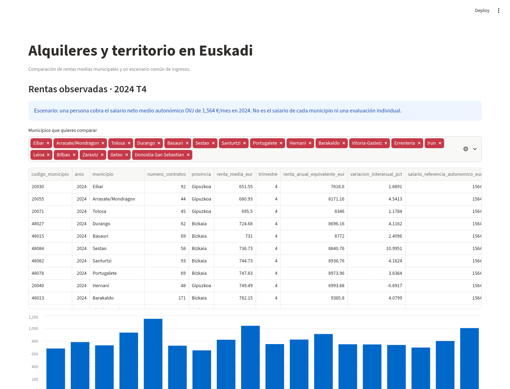

# Reto 1 · Acceso a la vivienda para jóvenes en Euskadi

Proyecto interdisciplinar del Curso de Especialización en Inteligencia Artificial y Big Data, IABD 2026–27.



## Qué hemos construido

La continuación incorpora una [captura trazable de anuncios](docs/SCRAPING.md),
con robots y TLS obligatorios. Sus pruebas usan fixtures; la captura real sigue
bloqueada por la red y no se presenta como requisito completado.
El incremento de adquisición supera **153 pruebas** y cinco de servicios reales;
el [intento actual](docs/evidencias_scraping_2026-11-11/intento_real.json) registra
cero anuncios y el bloqueo, sin fabricar un lote válido.

Una herramienta de orientación para comparar rentas municipales observadas,
estimar la referencia del siguiente trimestre y explicar reglas al usuario.
Es una IA débil de aprendizaje supervisado de regresión, especializada en EMAL;
no infiere solvencia individual. pandas prepara las tablas, sklearn compone el
preprocesado y los modelos, XGBoost aporta una familia de comparación, MLflow
registra experimentos y SHAP describe contribuciones sin causalidad. Streamlit
presenta referencias y n8n crea fichas locales tras consentimiento.

En la continuación del 11 de noviembre se verificaron **129 pruebas**, siete
pruebas con MongoDB real y cinco del recorrido HDFS/Kafka/MongoDB, sin skips.
El recorrido transportó 621 registros oficiales y cinco vistas municipales;
no acredita scraping de anuncios individuales. Ver [evidencias actuales](docs/evidencias_2026-11-11/)
y [contraste con enunciados y ejercicios](docs/CONTRASTE_DOCENTE.md).
El commit `1c7c45e` superó los CI remotos de
[BDA](https://github.com/markelalvarez0/Reto-1/actions/runs/43008668473) y
[n8n](https://github.com/markelalvarez0/Reto-1/actions/runs/43008668600).

El [PDF vigente versionado](Entrega_Reto1_IABD_Documentacion.pdf) sustituye los
cuatro PDF anteriores. `python main.py --pdf` genera el informe, figuras conservadas y manifiesto
de fuentes en `data/informe_entrega/`, sin ejecutar el modelo. Las entradas
históricas de generación delegan en este mismo generador.
[Guion de defensa de 15 minutos](docs/DEFENSA.md).

**Acceso y comparación territorial actualizados:** consultar [estado por asignatura y comandos](docs/ESTADO_ENTREGA.md).
`python main.py --audit --json` verifica la integridad sin ejecutar el modelo.
`python main.py --subject saa_pia_mia` abre directamente la aplicación conservada.
El análisis territorial usa MongoDB, rentas EMAL y un escenario salarial OVJ del mismo año.

**Versión de trabajo: `dev-jon`.** `main` y `test` no deben confundirse con la versión en desarrollo. La entrega global sigue pendiente de la revisión final de los dos bloques y de su integración verificada.

## Resultado publicado del bloque ML

El código estándar de ML está integrado desde `95db602`; el modelo, los datos originales, los resultados, los notebooks ejecutados y las capturas están conservados en el commit `4e5a927`.

**El test final YA está evaluado una vez. No hay que volver a entrenar ni abrir otra selección.**

| Conjunto | Observaciones | MAE (EUR) | RMSE (EUR) | R² |
|---|---:|---:|---:|---:|
| Validación 2024 | 75 | 24,20 | 31,86 | 0,9370 |
| Test reservado desde 2025 | 92 | 28,67 | 37,93 | 0,9189 |

Son errores de **renta media municipal trimestral**, no del precio de un inmueble ni de la viabilidad de una persona. R² no es un porcentaje de aciertos.

Acceso a los entregables conservados:

- [Modelo completo guardado](entrega_ml/models/best_model.joblib), [selección cerrada](entrega_ml/models/selection.json) y [comparativa de modelos](entrega_ml/resultados/comparativa_mlflow.csv).
- [Tres notebooks ejecutados](entrega_ml/notebooks_ejecutados/) y [capturas reales de Streamlit y MLflow](docs/evidencias_ml/capturas/).
- [Test final sellado](docs/TEST_FINAL_EMAL.json), [evidencia de ejecución única](docs/evidencias_ml/evaluacion_final.json) y [prueba de Streamlit con n8n](docs/evidencias_ml/streamlit-n8n.json).
- [Datos originales y manifiesto de fuentes](data/capturas_oficiales/) y [manifiesto de artefactos](docs/evidencias_ml/manifest.json).

La primera ejecución calculó el test correctamente, pero su empaquetado falló al intentar decodificar como UTF-8 un CSV original. La publicación posterior recuperó el resultado conservado, comprobó las huellas y escaneó los bytes sin alterar el CSV. **No se repitió la evaluación del test.**

## Pregunta y alcance

¿Qué referencias de alquiler y qué información verificable pueden utilizar los servicios de orientación para ayudar a jóvenes a estudiar sus opciones de vivienda en Euskadi?

Se separan tres objetos distintos:

1. **Anuncios y promociones:** describen inmuebles o promociones, con fuente, identificador y código municipal. Una promoción no equivale a un contrato individual.
2. **Estadísticas EMAL:** rentas medias y números de contratos por municipio y trimestre. Son observaciones agregadas, no anuncios ni perfiles de solicitantes.
3. **Orientación personal:** utiliza datos declarados en la app y reglas explicables. No concede ni deniega ayudas públicas y no transforma una predicción municipal en una puntuación de riesgo individual.

El antiguo objetivo `es_viable` se generaba artificialmente. Sus CSV y JSON históricos no acreditan resultados observados de emancipación; no son la base del modelo entregable nuevo.

## Estado respaldado por ejecuciones

| Componente | Evidencia y límite |
|---|---|
| Integridad INE | PR #2 integrada en `dev-jon`; un municipio desconocido no se convierte en Bilbao. |
| Suite del bloque ML publicado | 99 pruebas superadas; se mantienen avisos de librerías y de mini-tests con pocas iteraciones. |
| MongoDB | 6 pruebas adicionales con servidor MongoDB real en CI, separadas de `mongomock`. |
| HDFS y Kafka | Integración con servicios temporales reales en CI; los mensajes de prueba son fixtures declarados. |
| n8n | Ocho ramas, persistencia e idempotencia verificadas con servicio real. |
| MLflow y SHAP | Entrenamiento y artefactos reales sobre la captura oficial EMAL. |
| Notebooks y Streamlit | Tres notebooks ejecutados sin errores; formulario → modelo → reglas → acción n8n comprobado con un caso de prueba explícito y consentimiento. |
| Capturas | Chromium contra interfaces locales reales de Streamlit y MLflow, no imágenes generadas. |
| Test de ML | Evaluado una vez después de cerrar la selección; las reaperturas leen el mismo informe. |
| Entrega global | Pendiente de cerrar el recorrido Big Data con datos reales, dashboard, documentación completa y promoción controlada a `test`/`main`. |

Ejecuciones verificables:

- [Entrenamiento y 99 pruebas del bloque ML](https://github.com/markelalvarez0/Reto-1/actions/runs/42855647062).
- [MongoDB real: suite y pruebas de integración](https://github.com/markelalvarez0/Reto-1/actions/runs/42842995070).
- [HDFS y Kafka reales](https://github.com/markelalvarez0/Reto-1/actions/runs/42842995285).
- [n8n real después de corregir la disponibilidad del webhook](https://github.com/markelalvarez0/Reto-1/actions/runs/42854348068).
- [Notebooks y aplicación con modelo congelado](https://github.com/markelalvarez0/Reto-1/actions/runs/42856972138).
- [Evaluación única del test; fallo posterior solo de empaquetado](https://github.com/markelalvarez0/Reto-1/actions/runs/42858124305).
- [Recuperación y publicación correctas sin reevaluar](https://github.com/markelalvarez0/Reto-1/actions/runs/42858684151).

## Datos reales y aprendizaje automático

Los originales se recuperan con `scripts/capture_sources.py`, que conserva URL, fecha UTC, respuesta HTTP y SHA-256. Los fallos se registran, no se sustituyen por datos inventados etiquetados como reales.

La captura EMAL utilizada contiene **768 observaciones de 19 municipios**: 601 en entrenamiento hasta 2023, 75 en validación de 2024 y 92 separadas desde 2025 para la evaluación final. Se excluyen los objetivos no publicados, sin imputarlos. La serie está revisada a la fecha de captura: la evaluación es retrospectiva.

El modelo predice **renta media municipal trimestral**, usando año, trimestre, municipio, provincia y retardos observados de renta y contratos. Los retardos se construyen antes de separar los datos, sin utilizar valores contemporáneos del objetivo como entradas. Se evalúan predicciones a un paso con observaciones previas disponibles, no predicciones autónomas de varios trimestres futuros.

Se comparan regresión lineal, KNN, Random Forest, XGBoost y SVM, además de MLP base y tres experimentos. El preprocesado usa `ColumnTransformer`, `Pipeline`, `SimpleImputer`, `StandardScaler` y `OneHotEncoder`; se ajusta dentro del entrenamiento y de cada partición temporal de validación cruzada.

Selección en validación: **MLP de dos capas**, MAE **24,20 EUR**, frente a **24,63 EUR** del baseline de persistencia. La diferencia es pequeña y no demuestra por sí sola una mejora generalizable. No son métricas del precio de un piso individual. Después de esa selección se evaluó únicamente el ganador sobre el test: no se usaron sus resultados para cambiar el modelo.

SMOTE se aplica únicamente a una clasificación auxiliar de subida trimestral observada, nunca a la renta continua. La comparación sin/con balanceo conserva su resultado aunque no mejore F1. SHAP se calcula en validación con fondo de entrenamiento y no se interpreta causalmente.

Campos del conjunto de entrenamiento (601 filas; porcentajes medidos, no imputados):

| Campo | Significado | Tipo | Nulos train |
|---|---|---|---:|
| codigo_municipio | Código INE | categórica | 0 % |
| municipio / provincia | Territorio y denominación | categórica | 0 % |
| anio / trimestre / periodo | Tiempo de observación | entero | 0 % |
| renta_media_eur | Objetivo mensual agregado | real | 0 % |
| numero_contratos | Contratos del trimestre, sin usar el contemporáneo como entrada | real | 0 % |
| renta_lag1 | Renta un trimestre antes | real | 4,16 % |
| renta_lag4 | Renta cuatro trimestres antes | real | 13,64 % |
| contratos_lag1 | Contratos un trimestre antes | real | 3,00 % |

Los once objetivos no publicados se excluyen antes de construir el conjunto
supervisado. Los retardos faltan por construcción o ausencia de publicación;
la imputación se ajusta dentro de train/folds. El MLP conservado usa sklearn,
con base y tres experimentos; no se presenta como Keras.

Documentación: [metodología](docs/METODOLOGIA_ML.md) y [evidencia de validación previa al test](docs/EVIDENCIA_ML_VALIDACION.md). Las referencias a un test reservado en esa evidencia describen el estado anterior a la evaluación final registrada arriba.

## Organización

```text
src/                         Código canónico: extracción, datos, servicios, ML y reglas
scripts/capture_sources.py    Captura original trazable
scripts/train_official.py     Entrenamiento reproducible sin evaluar test por defecto
scripts/sync_sources.py       Sincronización y verificación de copias académicas
notebooks/                   01 EDA, 02 modelos, 03 SHAP (.ipynb)
app/streamlit_app.py          Aplicación del modelo guardado, reglas y n8n
entrega_ml/                  Modelo, particiones, MLflow, resultados y notebooks ejecutados
data/capturas_oficiales/      Originales conservados byte a byte
n8n/                         Workflow y servicios locales de demostración
integration_tests/           Pruebas separadas con servicios reales
tests/                       Suite de regresión y pruebas unitarias
.github/workflows/           Ejecuciones y conservación de evidencias
docs/                        Metodología y resultados comprobados
BDA + SBD/                   Carpeta de entrega del bloque Big Data
SAA + PIA + MIA/              Carpeta de entrega del bloque de IA
ainhoa/                      Copia académica heredada
```

`src/` es la fuente de verdad. Las tres copias se sincronizan; no se mantienen implementaciones alternativas manuales.

## Abrir y comprobar el bloque ML ya preparado

Entorno validado: **Python 3.12 en Linux**, con versiones efectivas registradas en `docs/evidencias_ml/entorno.txt`. La ejecución completa en Windows todavía no está verificada. Utilizar un entorno virtual y ejecutar desde la raíz del repositorio.

```bash
python -m pip install -r requirements-ci.txt
python -m pytest tests/ -q
python scripts/sync_sources.py --check
python -m streamlit run app/streamlit_app.py
```

La aplicación carga directamente el modelo conservado en `entrega_ml/`. **No hace falta entrenar para abrirla.** La pestaña **Test reservado** conserva su nombre, pero ahora muestra el informe final existente sin repetir la evaluación.

Abrir los tres `.ipynb` con un kernel del mismo entorno. Los notebooks consultan los experimentos existentes cuando la selección ya está cerrada. Sus versiones con salidas comprobadas están en `entrega_ml/notebooks_ejecutados/`.

Para reproducir la preparación inicial en un directorio NUEVO, sin sustituir los resultados publicados:

```bash
python scripts/train_official.py --raw data/capturas_oficiales --output reproduccion_ml
```

Esta ejecución es una reproducción del procedimiento, no una nueva oportunidad para seleccionar usando el test ya observado. No recapturar datos ni reentrenar para intentar mejorar resultados después de abrir el test. El script rechaza sobrescribir una selección existente. Para reproducir exactamente la evidencia publicada, conservar las fuentes, huellas y versiones del entorno registrado.

Los archivos `joblib` solo deben cargarse desde artefactos de confianza. MLflow guarda una base SQLite y artefactos con rutas locales; al trasladarlos a otro equipo hay que conservar o adaptar las rutas de los artefactos. El modelo completo de inferencia se encuentra de forma independiente en `entrega_ml/models/best_model.joblib`.

## n8n y protección de datos

```bash
docker compose -f n8n/compose.yml run --rm n8n import:workflow --input=/workflow/flujo.json
docker compose -f n8n/compose.yml run --rm n8n publish:workflow --id=reto1Vivienda2026
docker compose -f n8n/compose.yml up -d
```

La aplicación no envía acciones sin consentimiento. El cliente transmite solo identificador de evento, decisión, regla y referencia estimada; no envía nombre, salario, dirección ni expediente. Una respuesta HTTP por sí sola no se considera éxito: se exige confirmación de persistencia. El UUID conserva la idempotencia al repetir la misma acción.

Las acciones locales generan fichas o listas de comprobación distintas. **No envían SMS reales ni tramitan subvenciones.** La configuración Docker es una demostración local, no un despliegue de producción.

## Evaluación y límites de entrega

Los resultados heredados de `best_model.json`, `mlruns_data.json` y gráficos antiguos no sustituyen los artefactos nuevos ni deben presentarse como evidencia de datos reales. Los README y PDF históricos de cada bloque necesitan conciliación final con el código actualizado.

Las pruebas reales de la continuación acreditan las capturas oficiales y las
vistas municipales por HDFS → Kafka → MongoDB. Los mensajes de promociones y las
vistas agregadas conservan tipos diferentes. Quedan el scraping verificable de
anuncios individuales, el ensayo humano y
la integración final en `test`/`main`. La red actual bloquea los portales; no se
declara cumplimiento integral ni se sustituye una muestra ausente por datos ficticios.
