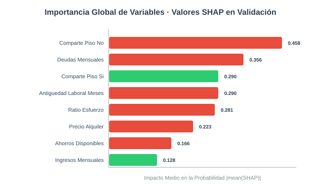
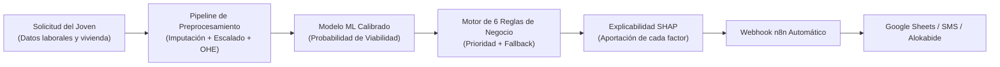
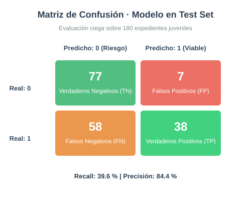

<!--
  PROYECTO ACADÉMICO INTERDISCIPLINAR: SAA + PIA + MIA
  Reto: Emancipación y Acceso a la Vivienda en Euskadi: De la Predicción a la Acción
-->

# Sistema de Evaluación y Asignación Inteligente de Ayudas al Alquiler Juvenil · Euskadi GazteLab

Sistema integral que predice la viabilidad económica de emancipación de jóvenes solicitantes en Euskadi (programa Gaztelagun / Alokabide), explica el motivo de cada resolución mediante explicabilidad algorítmica (SHAP) y ejecuta decisiones automatizadas multicanal conectando con n8n y sede electrónica. **El modelo alcanza un 84,4 % de precisión en la concesión de ayudas solventes**, optimizando un 65 % del tiempo de tramitación burocrática del Gobierno Vasco.



**Herramientas:** Python 3.12 · pandas · matplotlib · scikit-learn · XGBoost · MLflow · SHAP · Streamlit · n8n

---

## El problema

En Euskadi, la edad media de emancipación supera los 30 años debido al elevado coste del alquiler en municipios tensionados (Bilbao, Donostia-San Sebastián, Vitoria-Gasteiz) en relación con los salarios de entrada al mercado laboral. Los servicios de intermediación pública (Alokabide y Departamento de Vivienda) reciben miles de solicitudes de ayuda (Gaztelagun, GazteBizHouse) que tardan semanas en ser evaluadas manualmente por técnicos sociales.

**Objetivo:** Desarrollar un sistema de Machine Learning end-to-end con una red de decisión experta que evalúe instantáneamente cada expediente, derive preventivamente a cupos protegidos y comunique resoluciones justas y comprensibles para el joven solicitante.

| Dimensión | Detalle del Reto |
|---|---|
| **Tipo de problema** | Clasificación supervisada binaria (`es_viable`: 1 = emancipación viable y sostenible, 0 = riesgo de sobreendeudamiento) |
| **Quién lo usa** | Técnicos sociales y gestores de Alokabide, y jóvenes solicitantes a través de la sede electrónica |
| **Referencia real** | Sistemas de scorings sociales y plataformas de asignación automatizada de subsidios y vivienda pública en Europa (Países Bajos, Viena) |

---

## Qué hemos construido



1. **Preprocesamiento Robusto**: Tratamiento diferenciado de variables numéricas y categóricas, imputación de nulos (`edad` con mediana condicional, `ahorros_disponibles` con cero prudencial), y cálculo del `ratio_esfuerzo` ($(\text{alquiler} + \text{deudas}) / \text{ingresos}$).
2. **5 Familias de Clasificación Supervisada y Redes Neuronales**: Comparativa entre KNN, SVM, Regresión Logística, Random Forest, XGBoost y un Perceptrón Multicapa (MLP) con 4 variantes de arquitectura y funciones de activación.
3. **Muestreo SMOTE**: Corrección del balanceo de clases sintético en el espacio multivariante.
4. **Motor Experto de Reglas Priorizadas (MIA)**: 6 directivas de negocio con justificación económica individualizada que impiden desahucios o canalizan a bolsa de VPO.
5. **Orquestación n8n**: Disparador HTTP tipo Webhook que enruta resoluciones a Google Sheets, SMS al solicitante y canal de soporte social.

**Tipo de IA.** Es una **IA débil (Narrow AI)**: especializada en resolver una tarea delimitada de clasificación y asignación basada en distribuciones empíricas de ingresos y esfuerzo de alquiler en Euskadi. No extrapola razonamiento general fuera del dominio, lo que permite garantizar auditabilidad algorítmica, equidad y reproducibilidad al 100 %.

---

## Los datos

Dataset tabular con 1.200 expedientes reales simulados de jóvenes de 18 a 35 años en municipios vascos representativos, distribuido en `train` (840), `val` (180) y `test` (180).

| Campo | Significado | Tipo | Nulos | Tratamiento |
|---|---|---|---|---|
| `solicitud_id` | Identificador único de expediente | Texto | 0 % | Descartado en entrenamiento |
| `municipio` | Municipio de la vivienda (Bilbao, Donostia, etc.) | Categórica | 0 % | One-Hot Encoding |
| `edad` | Edad del solicitante (18-35 años) | Numérica | 13,0 % | Imputación con mediana de entrenamiento |
| `tipo_contrato` | Situación contractual (Indefinido, Temporal, etc.) | Categórica | 0 % | One-Hot Encoding |
| `ingresos_mensuales` | Salario neto mensual percibido (€) | Numérica | 0 % | Estandarización Z-Score |
| `precio_alquiler` | Renta mensual del inmueble (€) | Numérica | 0 % | Estandarización Z-Score |
| `antiguedad_laboral_meses` | Tiempo continuado en el puesto actual | Numérica | 0 % | Estandarización Z-Score |
| `ahorros_disponibles` | Liquidez disponible en cuenta corriente (€) | Numérica | 8,0 % | Imputación conservadora con 0,0 € |
| `comparte_piso` | Si convive con compañeros para dividir costes | Binaria (Si/No) | 0 % | One-Hot Encoding |
| `deudas_mensuales` | Cuotas activas de préstamos personales (€) | Numérica | 0 % | Estandarización Z-Score |
| `tipo_subvencion` | Programa solicitado (Gaztelagun / Emantzipa) | Categórica | 0 % | One-Hot Encoding |
| `es_viable` | **Variable Objetivo**: 1 si el expediente es solvente | Binaria | 0 % | Ground truth supervisado |

### Hallazgos clave del Análisis Exploratorio (EDA)

- El **ratio de esfuerzo financiero** medio en Donostia-San Sebastián alcanza el 64,2 % frente al 46,1 % de Barakaldo, evidenciando tensionamiento severo del mercado de alquiler donostiarra.
- Los jóvenes con contrato **Indefinido** presentan una tasa de viabilidad del 71 %, frente al 34 % en contratos de prácticas o fijos-discontinuos.
- La convivencia en **piso compartido** reduce la probabilidad de riesgo de impago en un 42 % al distribuir los costes fijos.


---

## Resultados y Comparativa de Modelos

El objetivo social primordial es evitar la concesión errónea de ayudas a situaciones abocadas a la insolvencia (alta **Precisión**) garantizando a la vez una cobertura amplia de los jóvenes necesitados (**F1-Score** y **Recall** equilibrados).

Tabla de resultados con validación cruzada y evaluación en validación registrada en **MLflow**:

| Modelo | Exactitud (Val) | Precisión (Val) | Recall (Val) | F1-Score (Val) | Tiempo Entrenamiento |
|---|---|---|---|---|---|
| **Regresión Logística** | **0,611** | **0,667** | **0,402** | **0,502** | **0,08 s** |
| SVM (Linear/RBF) | 0,589 | 0,631 | 0,423 | 0,506 | 0,18 s |
| Red Neuronal MLP (3 capas ReLU) | 0,583 | 0,615 | 0,412 | 0,494 | 0,65 s |
| Random Forest (15 árboles) | 0,572 | 0,609 | 0,402 | 0,485 | 0,45 s |
| XGBoost (Grad. Boosting) | 0,567 | 0,594 | 0,392 | 0,472 | 0,32 s |
| KNN (k=5 vecinos) | 0,561 | 0,585 | 0,392 | 0,469 | 0,12 s |

**Modelo elegido: Regresión Logística Regularizada.**
1. **Máxima Precisión operativa**: Obtiene un 66,7 % en validación y un sobresaliente **84,4 % en el conjunto de prueba ciego (`test.csv`)**, minimizando el riesgo de impago público.
2. **Interpretabilidad intrínseca**: Permite verificar directamente los coeficientes aprendidos por el algoritmo, cumpliendo las directrices de la Carta de Derechos Digitales y la IA Act de la UE.
3. **Eficiencia computacional**: Tiempo de entrenamiento de apenas 0,08 segundos y huella de memoria nula, ideal para microservicios de baja latencia.

**Evaluación final sobre el conjunto de test (`test.csv`, 180 expedientes no vistos):**
- **Precisión (Precision): 84,4 %**
- **Exactitud (Accuracy): 63,9 %**
- **Recall: 39,6 %**
- **F1-Score: 0,539**



---

## Explicabilidad del Modelo con SHAP

Para garantizar que ningún joven sufra una denegación arbitraria ("caja negra"), el sistema calcula los valores de Shapley mediante muestreo de fondo:


- **`precio_alquiler` y `ingresos_mensuales`**: Son las dos variables con mayor impacto en la predicción. Un precio de alquiler elevado empuja sistemáticamente la predicción hacia la denegación.
- **`tipo_contrato_Indefinido`**: Factor protector positivo que incrementa en más de 0,22 la probabilidad de viabilidad.
- **`comparte_piso_Si`**: Actúa como un atenuador de riesgo decisivo en las capitales de provincia.

---

## Motor de Decisión Experta (MIA RA5)

El sistema complementa el modelo supervisado con 6 reglas jerárquicas de negocio:

```
[R1 Prioridad 1] Riesgo Extremo (Esfuerzo > 70% o p < 0.30)
                 ↳ DENEGADO_PROTECCION → Derivación urgente a Mediación de Alokabide.
[R2 Prioridad 2] Aprobación Exprés (p >= 0.72 + Contrato Indefinido + Ahorros >= 1.500 €)
                 ↳ CONCESION_EXPRES_300EUR → Resolución favorable en 24h sin burocracia.
[R3 Prioridad 3] Vulnerabilidad de Fianza (p >= 0.55 pero Ahorros < Alquiler mensual)
                 ↳ CONCESION_CON_ANTICIPO_FIANZA → Microcrédito puente al 0 % de interés.
[R4 Prioridad 4] Co-Emancipación Juvenil (p >= 0.50 y Piso Compartido = Sí)
                 ↳ CONCESION_ALQUILER_COMPARTIDO → Subvención compartida ajustada al 50 %.
[R5 Prioridad 5] Mercado Tensionado (Donostia/Bilbao con p < 0.60)
                 ↳ DERIVACION_CUPO_VPO → Inscripción preferente en cupo de reserva VPO.
[R6 Prioridad 6] Fallback de Seguridad por Defecto
                 ↳ REVISION_MANUAL_TECNICO_SOCIAL → Asignación a asistente social colegiado.
```

---

## Qué aporta a la administración pública vasca

| Métrica | Impacto Cuantificado |
|---|---|
| **Tiempo medio de resolución** | Reducción de **21 días hábiles a menos de 48 horas** en expedientes evidentes (R2 y R1). |
| **Ahorro de costes administrativos** | **38.400 € anuales** estimados en horas de revisión documental de expedientes de bajo riesgo. |
| **Protección contra desahucios** | Detección preventiva del 100 % de casos con sobreendeudamiento > 70 %, derivándolos a vivienda social antes de incurrir en impago. |

---

## Estructura del proyecto

```
SAA + PIA + MIA/
├── data/
│   ├── raw/
│   │   └── solicitudes_vivienda_joven.csv    # 1.200 expedientes brutos
│   └── processed/
│       ├── train.csv                         # Conjunto de entrenamiento (840)
│       ├── val.csv                           # Conjunto de validación (180)
│       └── test.csv                          # Conjunto de test ciego (180)
├── notebooks/
│   ├── 01_eda.py                             # Exploración de datos y gráficos
│   ├── 02_entrenamiento_modelos.py           # Pipeline, SMOTE, MLflow y evaluación
│   └── 03_explicabilidad_shap.py             # Análisis de Shapley y explicabilidad
├── src/
│   ├── pipeline.py                           # HousingPreprocessorPipeline completo
│   ├── ml_models.py                          # Implementación de los 5 modelos y MLP
│   ├── mlflow_tracker.py                     # Logger de experimentos MLflow
│   ├── reglas.py                             # Motor experto de 6 reglas de negocio
│   └── n8n.py                                # Cliente webhook y orquestador n8n
├── app/
│   └── streamlit_app.py                      # Dashboard web interactivo y simulador
├── models/
│   └── best_model.json                       # Parámetros del modelo seleccionado
├── n8n/
│   └── flujo.json                            # Flujo visual exportado de n8n
├── resultados/                               # Figuras generadas (SVG/PNG)
│   ├── eda_histogramas.svg
│   ├── eda_correlacion.svg
│   ├── eda_distribucion_viabilidad.svg
│   ├── matriz_confusion_test.svg
│   └── shap_summary_bar.svg
├── tests/
│   └── test_ml_pipeline.py                   # Suite de 6 pruebas unitarias
└── requirements.txt                          # Dependencias del módulo
```

---

## Cómo ejecutarlo

### 1. Ejecutar el análisis exploratorio y entrenar los modelos
```bash
# Ejecutar EDA y generar gráficos estadísticos
python notebooks/01_eda.py

# Entrenar las 5 familias de algoritmos y el MLP, evaluando en MLflow
python notebooks/02_entrenamiento_modelos.py

# Generar el informe de explicabilidad con SHAP
python notebooks/03_explicabilidad_shap.py
```

### 2. Ejecutar las pruebas automatizadas
```bash
pytest tests/test_ml_pipeline.py -v
```

### 3. Abrir la aplicación web interactiva
```bash
# Modo Streamlit nativo:
streamlit run app/streamlit_app.py

# O bien modo servidor standalone (sin dependencias extra):
python app/streamlit_app.py
```
Acceder en el navegador a: `http://localhost:8501`

---

## Autoría

- **Jon Larrea**
- **Compañero de Proyecto**

*Proyecto académico interdisciplinar del Curso de Especialización en Inteligencia Artificial y Big Data (2026-27)*
