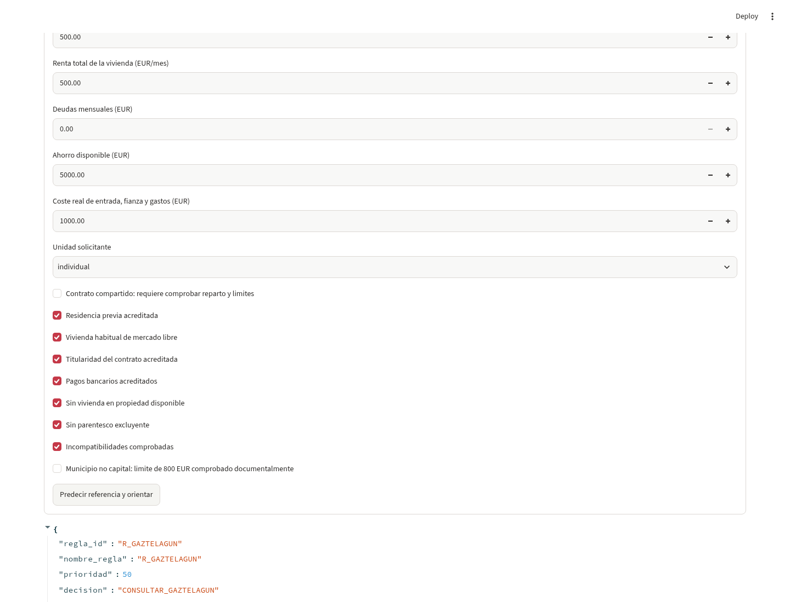
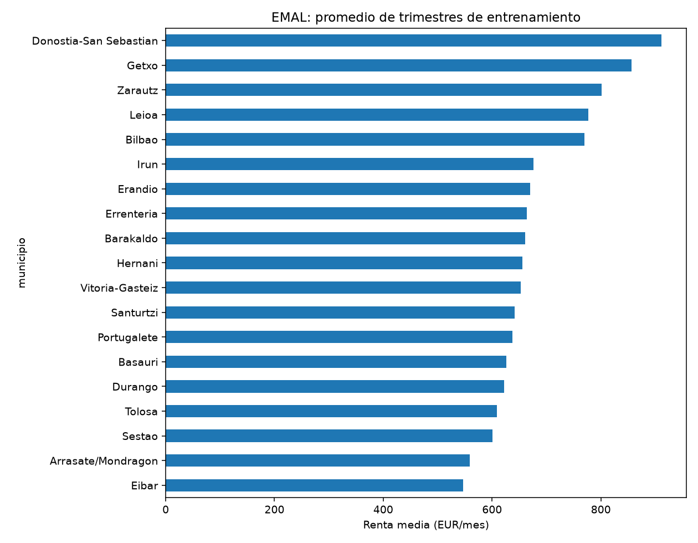
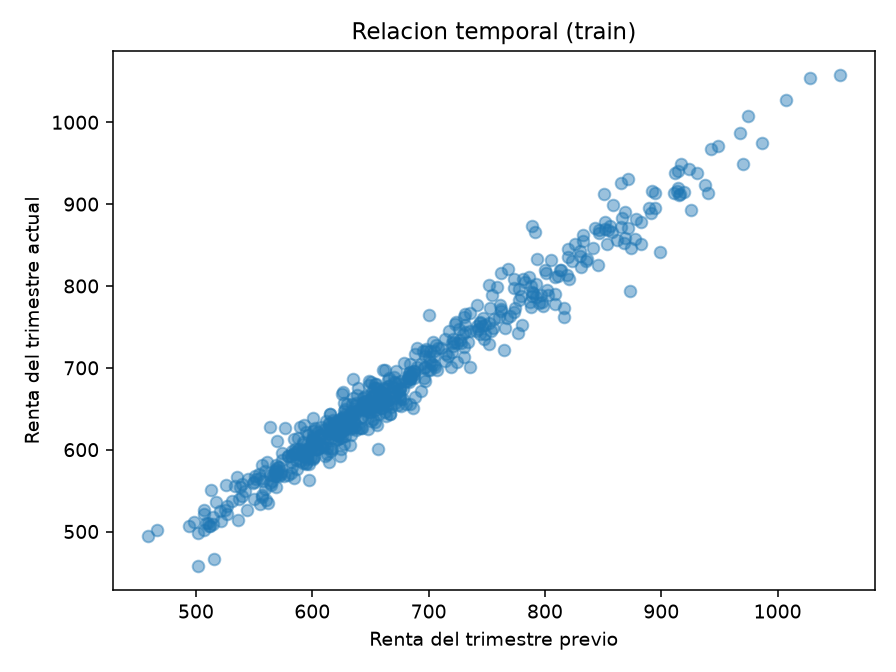
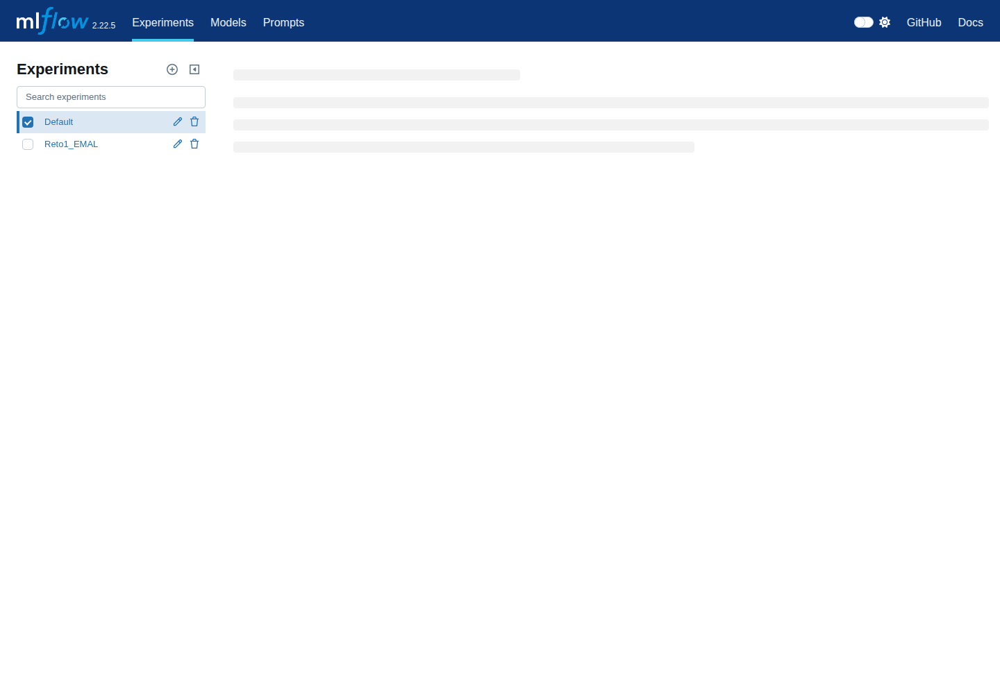
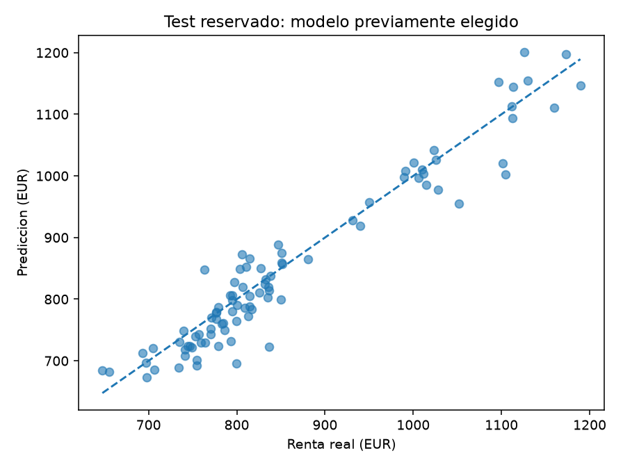

# Reto 1 · De la referencia de alquiler a la orientación explicable

Cierre de rúbricas: **168 pruebas**, 12 integraciones reales y CI Windows/Linux,
MongoDB y BDA correctos. Nueva regla de referencia y API JSON EMAL acreditadas.
El código se integró en test/main; guion oral y preguntas preparados. El ensayo
humano sigue pendiente. Detalle en docs/CIERRE_RUBRICA.md desde la raíz.



Captura real de Streamlit con un perfil inventado de prueba; no es un expediente personal.

**SAA + PIA + MIA · IABD 2026–27 · Rama de trabajo `dev-jon`**

El bloque utiliza estadísticas públicas de alquiler para estimar una **renta media municipal trimestral** y una aplicación de orientación que combina esa referencia con datos declarados y reglas explícitas. El flujo n8n genera una ficha o lista de comprobación; **no concede ni deniega ayudas, no se conecta a una sede electrónica y no envía SMS reales**.

El resultado publicado incluye nueve experimentos de regresión, una comparación auxiliar de clasificación con/sin SMOTE, MLflow real, SHAP, tres notebooks ejecutados y una comprobación de Streamlit con n8n real. Las evidencias se enlazan abajo. Esto no equivale a certificar que todos los entregables de los dos bloques estén terminados.

## El problema y la decisión sobre los datos

Se necesita distinguir la referencia estadística de alquiler de un anuncio individual y de la situación personal de un joven. El objetivo anterior `es_viable` se obtenía mediante generación sintética: no era una etiqueta observada de emancipación ni una resolución administrativa.

Por eso el modelo entregable aprende una variable observada en **EMAL**. Los datos personales introducidos en la aplicación se utilizan en las reglas de orientación, no se presentan como expedientes reales de entrenamiento.

| Elemento | Definición utilizada |
|---|---|
| Unidad de observación | Municipio y trimestre; estadística agregada. |
| Variable objetivo | Renta media mensual de los contratos observados en ese municipio y trimestre, expresada en euros. |
| Entradas | Año, trimestre, municipio, provincia y retardos de renta y número de contratos disponibles antes del periodo objetivo. |
| Cobertura efectiva | 768 observaciones de 19 municipios; no representa todos los municipios de Euskadi. |
| Entrenamiento | 601 observaciones hasta 2023. |
| Validación | 75 observaciones de 2024. |
| Test final | 92 observaciones desde 2025, evaluadas solo después de cerrar la selección. |
| Nulos del objetivo | 11 valores no publicados excluidos; no se fabrican etiquetas ni se imputan objetivos. |

La fuente capturada es una serie revisada. La evaluación es retrospectiva a un paso, con retardos observados; no demuestra predicción autónoma de varios trimestres futuros ni acceso histórico a cada revisión de la fuente.

Fuentes y contratos: [originales con manifiesto](../data/capturas_oficiales/), [procedencia del dataset](../entrega_ml/data/procedencia.json), [metodología detallada](../docs/METODOLOGIA_ML.md).

## Qué está implementado

El recorrido es:

```text
Original EMAL + procedencia
    → parseo y normalización municipal
    → EDA y partición temporal
    → pipeline sklearn ajustado en entrenamiento
    → comparación en validación + registro MLflow
    → modelo seleccionado + SHAP sobre validación
    → aplicación Streamlit
    → reglas de orientación
    → consentimiento explícito
    → webhook n8n → acción local persistida e idempotente
```

El preprocesamiento utiliza `ColumnTransformer`, `Pipeline`, `SimpleImputer`, `StandardScaler` y `OneHotEncoder` de scikit-learn. No son reimplementaciones manuales con nombres de librerías. Los estimadores proceden de scikit-learn y XGBoost; SMOTE procede de imbalanced-learn.

Las cinco familias principales son regresión lineal, KNN, Random Forest, XGBoost y SVM. Se añade una MLP base y tres variantes, usando `MLPRegressor` de scikit-learn. La selección utiliza validación temporal y no consulta el test. Los modelos guardados incluyen el preprocesador ajustado.

## Notebooks y EDA

| Notebook | Contenido |
|---|---|
| [01_eda.ipynb](notebooks/01_eda.ipynb) | Procedencia, estructura, nulos, duplicados, particiones y cinco gráficos de entrenamiento con interpretación. |
| [02_entrenamiento_modelos.ipynb](notebooks/02_entrenamiento_modelos.ipynb) | Comparativa, configuración, errores de entrenamiento/validación, baseline, experimentos MLP y SMOTE auxiliar. |
| [03_explicabilidad_shap.ipynb](notebooks/03_explicabilidad_shap.ipynb) | Explicación real del ganador, ranking de contribuciones y límites de interpretación. |

Las versiones con salidas ejecutadas están en [entrega_ml/notebooks_ejecutados](../entrega_ml/notebooks_ejecutados/). La [evidencia de ejecución](../docs/evidencias_ml/notebooks.json) confirma cero errores en los tres notebooks. Reabrirlos no reentrena silenciosamente si ya existe una selección cerrada.

## Comparativa de modelos

Errores de **validación**, no resultados del test:

| Modelo | MAE (EUR) | RMSE (EUR) | R² |
|---|---:|---:|---:|
| **MLP de dos capas** | **24,20** | **31,86** | **0,9370** |
| Random Forest | 25,15 | 34,76 | 0,9250 |
| MLP regularizada | 25,42 | 34,03 | 0,9282 |
| MLP base | 25,78 | 34,38 | 0,9267 |
| XGBoost | 26,52 | 37,05 | 0,9148 |
| Regresión lineal | 31,17 | 40,58 | 0,8978 |
| MLP tanh | 35,16 | 50,79 | 0,8400 |
| SVM | 37,86 | 55,56 | 0,8085 |
| KNN | 51,52 | 60,89 | 0,7700 |

El baseline de persistencia obtiene MAE **24,63 EUR**. La mejora del ganador es de aproximadamente **0,43 EUR**: es pequeña, y debe comunicarse sin presentarla como una superioridad general demostrada. KNN presenta un error de entrenamiento casi nulo pero peor validación, señal compatible con sobreajuste.

La [tabla exportada de MLflow](../entrega_ml/resultados/comparativa_mlflow.csv) conserva los valores precisos, tiempos y registros de experimentos. La base SQLite y los artefactos están en [entrega_ml/mlruns](../entrega_ml/mlruns/).

## SMOTE: experimento auxiliar, no aplicado a una renta continua

Se compara una clasificación de **subida trimestral observada**, utilizando información previa y remuestreando solo entrenamiento mediante un pipeline de imbalanced-learn.

| Variante | F1 de validación | Accuracy de validación |
|---|---:|---:|
| Sin SMOTE | 0,8254 | 0,7067 |
| Con SMOTE | 0,8167 | 0,7067 |

No se oculta que SMOTE no mejora F1 en esta comparación. Este experimento no predice elegibilidad, impago ni derechos personales y no justifica aplicar SMOTE al objetivo continuo de regresión. [Resultado completo](../entrega_ml/resultados/comparacion_smote.json).

## SHAP

Se utiliza `shap.Explainer` con permutaciones sobre el modelo seleccionado. El fondo contiene 30 filas de entrenamiento y se explican 30 filas de validación. Las contribuciones están expresadas en euros de renta municipal.

El ranking describe el comportamiento del modelo. No prueba causalidad ni justifica convertir una diferencia entre municipios en una resolución sobre una persona. [Resultados y metadatos](../entrega_ml/resultados/).

## Evaluación final única

La MLP de dos capas se evaluó una vez sobre el conjunto reservado:

| Medida | Resultado |
|---|---:|
| Observaciones de test | 92 |
| MAE | 28,6656 EUR |
| RMSE | 37,9285 EUR |
| R² | 0,91893 |

[Informe sellado](../docs/TEST_FINAL_EMAL.json) y [evidencia de ejecución](../docs/evidencias_ml/evaluacion_final.json).

La evaluación se activó desde Streamlit, con huellas del modelo y del test comprobadas. La reapertura mostró el mismo informe sin recalcular. No se reajustaron hiperparámetros ni se eligió otro modelo después de ver ese resultado. R² no es accuracy y estos errores no miden viabilidad individual.

El empaquetado inicial falló después del cálculo por la codificación de un CSV original. Se recuperó el artefacto conservado y se publicó sin repetir la evaluación ni alterar los originales.

## Motor de reglas y n8n

Las reglas se aplican por prioridad descendente, con seguridad primero. La configuración distingue datos inválidos, vigencia de la convocatoria, esfuerzo crítico, comprobación de requisitos, documentación pendiente, alternativas de vivienda, gastos de entrada, consulta de Gaztelagun e información general.

La probabilidad del antiguo clasificador sintético no interviene en concesiones. Los umbrales internos de esfuerzo son orientativos y se distinguen de los requisitos parametrizados. Los casos incompletos o no cubiertos se remiten a revisión; la aplicación no sustituye la resolución administrativa.

El workflow utilizado y probado es el de la **raíz del repositorio**: [n8n/flujo.json](../n8n/flujo.json), junto con [n8n/compose.yml](../n8n/compose.yml). Los archivos antiguos de esta carpeta no deben confundirse con ese flujo validado.

Se han verificado ocho ramas de acción con n8n real. La prueba conjunta de Streamlit verifica formulario, carga del modelo, consentimiento previo, recepción del webhook y persistencia de una ficha `checklist_gaztelagun`. Repetir el mismo evento no duplica la acción. El payload no contiene salario, nombre ni domicilio. [Evidencia conjunta](../docs/evidencias_ml/streamlit-n8n.json).

## Abrir la aplicación ya preparada

Ejecutar desde la **raíz del repositorio**, no desde una carpeta académica aislada. Entorno comprobado: Python 3.12 en Linux. La revisión a623ece pasó en Linux y Windows con instalación desde uv.lock, 159 pruebas, generación de PDF y ambas aplicaciones.

```bash
python -m pip install -r requirements-ci.txt
python -m pytest tests/ -q
python -m streamlit run app/streamlit_app.py
```

El modelo se carga desde `entrega_ml/models/best_model.joblib`. No se necesita reentrenar. El botón de evaluación no debe volver a utilizarse sobre otra copia del test: el informe publicado ya está disponible.

La integración n8n requiere los servicios locales descritos en el [README de la raíz](../README.md). Sin esos servicios, la app debe informar del error de envío, no simular un éxito.

## Evidencias y límites

Se conservan **99 pruebas superadas, cero fallos, cero errores y cero omitidas**, [XML de resultados](../docs/evidencias_ml/tests.xml). Hay avisos de deprecación de dependencias y de convergencia en mini-tests deliberadamente cortos; no se presentan como una validación de equidad o impacto social.

Las [capturas de interfaz](../docs/evidencias_ml/capturas/) se obtuvieron con Chromium sobre Streamlit y MLflow en ejecución. Los datos originales, modelos, métricas y notebooks están en Git, no solamente en artefactos temporales de Actions.

El cierre del 12 de noviembre actualiza los cuatro PDF, acredita 17 anuncios por HDFS/Kafka/MongoDB y valida Windows/Linux; el código se integró en test/main. El repositorio se entrega como conjunto y las entradas se ejecutan desde su raíz. Las rutas históricas de artefactos MLflow pueden requerir adaptación al mover su visor; la app carga el modelo independiente conservado. El ensayo oral individual sigue pendiente.

No se atribuyen ahorros de costes, reducciones de plazos administrativos, prevención de desahucios ni integración con organismos públicos: no existen mediciones que sostengan esas afirmaciones en este proyecto.

## Material histórico

Los CSV `solicitudes_vivienda_joven.csv`, los antiguos `data/processed/*.csv`, `models/best_model.json`, `mlruns_data.json` y SVG anteriores se conservan como historial académico, pero **no forman parte de la evidencia del modelo real publicado**. No se deben mezclar sus métricas con las de EMAL ni llamarlos expedientes reales.

## Autoría

- **Jon Larrea**
- **Compañero de Proyecto**

Proyecto académico interdisciplinar del Curso de Especialización en Inteligencia Artificial y Big Data, 2026–27. La revisión técnica y las ejecuciones quedan trazadas en los commits y en GitHub Actions.

## Necesidad del servicio de orientación

En Bilbao, EMAL publica 930,31 €/mes en 2024 T4. Frente al salario autonómico OVJ
2024 de 1.564 €/mes, pagar íntegra esa renta representa un escenario del 59,48%.
No es el salario de Bilbao ni el porcentaje de jóvenes que no puede emanciparse.
Los servicios de orientación necesitan referencias verificables para comparar
municipios y presupuestos. El sistema predice la renta media municipal del siguiente
trimestre; la regla R_REFERENCIA compara esa predicción con el ingreso declarado
y puede recomendar estudiar alternativas. El beneficio esperado es facilitar esa
comparación; no hemos medido ahorro de tiempo ni impacto social.

```text
EMAL → modelo conservado → referencia municipal predicha
     → reglas + perfil declarado → decisión → consentimiento → n8n → ficha local
```

Es IA débil porque resuelve una tarea concreta aprendida de EMAL. Una IA fuerte
supondría capacidades generales de razonamiento y transferencia que este sistema
no posee. El aprendizaje es supervisado porque cada entrada histórica se asocia
a una renta objetivo observada. En aprendizaje no supervisado se buscarían grupos
o estructuras sin esa variable objetivo; no es lo que entrenamos aquí.

## EDA y resultados visibles



Las medias de entrenamiento difieren entre municipios; son agregados trimestrales,
no precios de ofertas individuales. Esa heterogeneidad justifica incluir territorio.



La relación con el trimestre anterior justifica comparar contra persistencia.
La pequeña mejora del ganador no acredita superioridad generalizable.

La tabla siguiente es una transcripción de `entrega_ml/resultados/comparativa_mlflow.csv`;
los tiempos son históricos del entrenamiento conservado, no una ejecución nueva.

| Modelo | MAE train | RMSE train | R² train | MAE val | RMSE val | R² val | Tiempo (s) |
|---|---:|---:|---:|---:|---:|---:|---:|
| MLP_2_capas | 15.8800 | 22.3526 | 0.9558 | 24.1970 | 31.8597 | 0.9370 | 0.0799 |
| Random_Forest | 5.9217 | 9.0960 | 0.9927 | 25.1507 | 34.7620 | 0.9250 | 1.8462 |
| MLP_regularizada | 14.7771 | 21.2229 | 0.9601 | 25.4173 | 34.0273 | 0.9282 | 0.1250 |
| MLP_base | 14.2235 | 19.8385 | 0.9652 | 25.7799 | 34.3755 | 0.9267 | 0.1260 |
| XGBoost | 11.6437 | 16.3124 | 0.9765 | 26.5234 | 37.0516 | 0.9148 | 0.2494 |
| Regresion_lineal | 12.7637 | 16.6719 | 0.9754 | 31.1665 | 40.5837 | 0.8978 | 0.2258 |
| MLP_tanh | 16.9724 | 23.4404 | 0.9514 | 35.1592 | 50.7876 | 0.8400 | 0.1391 |
| SVM | 10.6001 | 16.5865 | 0.9757 | 37.8630 | 55.5557 | 0.8085 | 0.1856 |
| KNN | 0.0000 | 0.0000 | 1.0000 | 51.5196 | 60.8912 | 0.7700 | 0.0917 |



Captura histórica real de los experimentos conservados; no es una nueva selección.
Se conserva MLP_2_capas por MAE de validación (24,20 €), frente a persistencia
(24,63 €). El error se refiere a una referencia municipal, no a la tasación de un piso.



MAE final 28,67 €, RMSE 37,93 € y R² 0,9189, sobre 92 observaciones. Esta figura
es la evaluación única ya conservada; no se vuelve a calcular para el README.

## Relación con las prácticas de clase

Se reutilizan los principios de requests/BeautifulSoup, pandas, Pipeline,
ColumnTransformer, escalado, codificación, GridSearchCV y joblib/Streamlit.
KFold_GridSearch.pdf contempla TimeSeriesSplit para datos temporales: su uso aquí
es una adaptación al dato, no se presenta como novedad no vista en clase.
La red utiliza MLPRegressor de sklearn; las prácticas usan Sequential/Dense/Adam.
Kafka utiliza kafka-python-ng en lugar de confluent_kafka y HDFS usa WebHDFS REST
en lugar de hdfs.InsecureClient. Son APIs distintas para los mismos servicios.
SHAP con validación y el experimento auxiliar SMOTE amplían los ejercicios aportados.
No afirmamos que sean nuevos en todo el curso ni garantizamos los puntos de novedad.
La comparativa sin/con SMOTE conserva F1 0,8254/0,8167: esa ampliación no mejoró F1.
