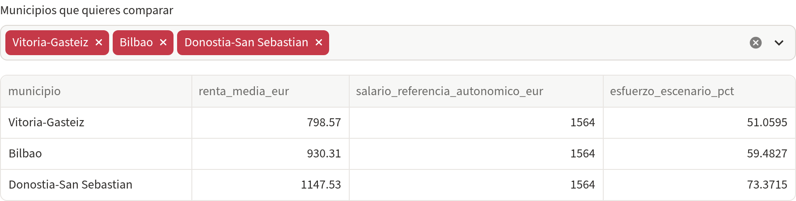

# Documentación BDA y SBD

## 1 Qué queríamos averiguar

Queríamos estudiar cuánto cuesta alquilar una vivienda en distintos municipios de Euskadi y qué parte de un sueldo joven podría llevarse ese alquiler. La idea era preparar una comparación que ayudara a entender la dificultad de emanciparse. Para ello necesitábamos conocer tanto el coste de la vivienda como el ingreso con el que lo comparamos.

Hemos creado un recorrido en Python que recoge información, guarda los archivos originales, organiza los datos en MongoDB y prepara resultados para un visor. En esta memoria explicamos las decisiones que hemos tomado: para qué sirve cada parte, qué consultas hemos hecho y qué hemos aprendido al comprobar sus resultados.

El resultado más claro es que, usando el mismo ingreso de referencia, Vitoria-Gasteiz presenta el menor esfuerzo de las tres capitales en el cuarto trimestre de 2024. Aun así, pagar toda su renta media supone el 51,06 % de ese ingreso. Esta comparación ayuda a entender el problema, pero no basta para decidir dónde puede vivir una persona concreta: también influyen su sueldo, con quién comparte vivienda y sus demás gastos.

## 2 Qué datos hemos usado y qué significa cada cifra

Hemos combinado fuentes porque cada una aporta una parte de la información. Los anuncios muestran lo que se pide por alquilar; EMAL permite consultar medias de contratos; y las fuentes oficiales de promociones dan información de proyectos de vivienda.

| Fuente | Qué hemos recogido | Por qué nos sirve |
|---|---|---|
| EMAL, archivo Excel | Rentas y contratos por municipio y trimestre | Comparar municipios y ver cómo cambia el alquiler con el tiempo |
| API del visor EMAL | Tres estadísticas de renta de 2024 T4 | Obtener importes directamente de un servicio consultable desde Python |
| Habitaclia y Pisos.com | 17 anuncios de alquiler | Practicar la extracción de anuncios y consultar precio, tamaño y condiciones |
| Visesa y Etxebide | 621 registros de promociones aceptados | Conservar y situar información de proyectos de vivienda |
| INE | Códigos oficiales de municipios | Reconocer el mismo municipio aunque su nombre se escriba de forma distinta |
| Observatorio Vasco de la Juventud, OVJ | Salario medio joven de Euskadi en 2024 | Hacer una comparación con el mismo ingreso de referencia |

**Una promoción no equivale a un piso.** Por ejemplo, un proyecto de un edificio con 30 viviendas puede aparecer como una promoción. Por eso, los 621 registros de promociones no nos dicen por sí solos cuántos pisos representan. Se reparten en 215 registros de Visesa y 406 de Etxebide, y ambas fuentes podrían mencionar un mismo proyecto.

**Los 638 registros salen de sumar 621 promociones y 17 anuncios.** Usamos esa cifra para comprobar que los datos han llegado completos a la base de datos. No significa que hayamos encontrado 638 pisos diferentes. Además, un mismo piso podría estar anunciado en los dos portales con identificadores distintos.

Las tres estadísticas recibidas por la API se guardan aparte. También separamos estas cifras de las del modelo de IA: ese modelo utiliza observaciones EMAL por municipio y trimestre. Los 17 anuncios no son sus datos de entrenamiento.

## 3 Cómo recogimos la información y por qué usamos dos métodos

**La API nos entrega datos ya organizados.** Desde Python pedimos al visor EMAL la renta de Bilbao, Donostia y Vitoria para el cuarto trimestre de 2024, indicando nuevos contratos, vivienda habitual y edificio colectivo. Guardamos la dirección completa de cada petición para poder revisar qué filtros utilizamos.

La respuesta dio 930,3 €/mes para Bilbao, 1.147,5 para Donostia y 798,6 para Vitoria. El Excel tiene más decimales; la API redondea a una décima. Aprendimos que una pequeña diferencia entre dos salidas puede deberse al redondeo y debe comprobarse antes de considerarla un error.

**El scraping nos permite recoger información de los anuncios.** Usamos `requests` para descargar el HTML de los listados y `BeautifulSoup` para localizar las tarjetas de las viviendas. De ellas extraemos el precio, la superficie, las habitaciones, los baños, la ubicación y el enlace. Así pasamos de una página pensada para leerla a unos datos que podemos consultar desde un programa.

En la captura del 12 de noviembre de 2026 pusimos un límite de tres anuncios interpretables por ciudad y portal. Obtuvimos nueve de Habitaclia y ocho de Pisos.com: seis en Bilbao, seis en Donostia y cinco en Vitoria. En Pisos.com Vitoria solo obtuvimos dos interpretables. Es una muestra pequeña, elegida para comprobar el recorrido; no es una selección representativa de todos los alquileres.

Al principio fallaron algunas direcciones antiguas y la forma de localizar los anuncios dentro del HTML. Conservamos ese intento y corregimos las rutas y los selectores a partir de lo recibido. Esto nos enseñó que un scraper depende de cómo esté construida la web y puede dejar de funcionar si cambia.

Antes de acceder comprobamos `robots.txt`, el archivo donde el portal publica sus reglas de acceso automatizado. Dejamos pausas entre peticiones y detenemos la captura ante los bloqueos previstos en el código. Guardamos también el HTML original: si un anuncio cambia o desaparece, podemos revisar qué información leímos aquel día. Las reglas de robots no sustituyen las condiciones de uso del portal.

:::flow Leer el listado HTML | Extraer los campos | Comprobar los datos | Guardar en JSON

Las respuestas de la API y sus filtros están guardados en `data/capturas_api_rentas/2026-11-12/`. Abrir ahora estos archivos permite revisar la captura conservada; no comprueba que los anuncios sigan disponibles.

## 4 Por qué conservamos los archivos originales

Antes de cambiar formatos o calcular resultados, guardamos los archivos tal como llegaron. Junto a ellos conservamos la URL, la fecha de descarga y una huella digital llamada SHA-256, que permite comprobar si su contenido ha cambiado.

Hemos separado los originales de los datos preparados porque podemos equivocarnos al limpiar. Si una conversión de precios sale mal, necesitamos volver a ver lo que publicó la fuente. Guardar solo la tabla final nos haría perder esa posibilidad.

También distinguimos la fecha de descarga del periodo de los datos. Un archivo descargado en noviembre de 2026 puede contener estadísticas de 2024. Para comparar alquiler y sueldo usamos el año al que se refieren las cifras, no el día en que bajamos el archivo.

Comprobar estas huellas nos ayuda a trabajar con las mismas copias en Windows y Linux. Lo que hemos aprendido aquí es que una cifra resulta más fácil de defender cuando podemos enseñar su origen y repetir su preparación.

## 5 Para qué sirve cada parte del recorrido

:::flow Recoger datos | Prepararlos | Guardarlos en HDFS | Enviarlos con Kafka | Consultar MongoDB | Mostrar el visor

**Python prepara la información.** Las fuentes llegan como Excel, CSV, JSON o HTML. Les damos una estructura común y comprobamos campos necesarios, como el municipio y la identidad del registro. Esto permite que las siguientes partes trabajen de una forma más uniforme.

**HDFS conserva los archivos.** Lo usamos para organizar originales y procesados, recuperarlos y comprobar que siguen iguales. Con nuestra muestra no hace falta un sistema distribuido por su tamaño; lo utilizamos para aprender el almacenamiento y la recuperación que pide el reto. La prueba útil consiste en recuperar los archivos y comprobar su contenido, además de haberlos subido.

**Kafka comunica las dos partes del proceso.** Un programa publica los registros y otro los recibe para guardarlos. Así practicamos que quien recoge información y quien la almacena puedan trabajar por separado. Reproducimos un lote archivado; no estamos recibiendo anuncios nuevos continuamente desde las webs.

**MongoDB organiza los datos para consultarlos.** Nos encaja porque las fuentes comparten algunos campos, pero no todos. Un anuncio puede incluir precio y habitaciones, mientras que una promoción puede no tener un precio mensual individual. Podemos guardar esas diferencias sin inventar los valores que faltan. PyMongo es la herramienta que usamos desde Python para comunicarnos con MongoDB.

**El visor enseña las salidas preparadas.** En lugar de copiar las medias a mano, los scripts calculan los resultados y el visor los representa. Esto facilita repetir el análisis y saber de dónde sale lo que vemos.

En la ejecución conservada, recuperamos 31 archivos del lote principal sin cambios y llegaron 638 registros a MongoDB. El recorrido de la API recuperó otros seis archivos y mantuvo tres estadísticas. Estas comprobaciones nos ayudan a detectar pérdidas o cambios entre una parte y otra.

## 6 Cómo evitamos guardar dos veces lo mismo

Si repetimos la carga porque ha fallado una conexión o queremos comprobarla otra vez, no queremos que el mismo anuncio se convierta en dos documentos. Eso aumentaría los recuentos y podría alterar las medias.

Para reconocer cada registro usamos **la fuente y su identificador original juntos**. Si esa pareja ya existe, actualizamos su documento; si no existe, lo creamos. Esta operación se llama `upsert`. Usar ambos campos evita confundir dos registros de portales diferentes que tengan el mismo identificador.

Añadimos además una restricción de unicidad para esa pareja. Kafka confirma un mensaje después de que se haya guardado. Si la escritura falla, no se da por terminada; al volver a recibir el mensaje, la misma identidad permite repetir el intento sin crear otra copia.

Lo comprobamos volviendo a cargar los 17 anuncios: la colección siguió teniendo 638 documentos. La API también mantuvo sus tres estadísticas al repetir. Hemos aprendido que la prueba importante es repetir una carga y revisar el resultado. Este control detecta repeticiones del mismo registro de origen; todavía no identifica un mismo piso anunciado en dos webs distintas.

## 7 Por qué hemos organizado así la base de datos

En MongoDB, una **colección** es un grupo de documentos y cada **documento** es una ficha con sus datos. Hemos separado la información según lo que representa y cómo vamos a utilizarla.

**Los anuncios y las promociones comparten la colección `viviendas`.** Ambos tienen fuente, identificador, municipio y procedencia, y aprovechamos el mismo proceso de carga. Para distinguirlos guardamos su tipo de registro. Al consultar alquileres filtramos las promociones, porque una ficha de un proyecto no equivale a una oferta de alquiler con precio mensual. Esta separación dentro de la colección es necesaria para que las consultas respondan a la pregunta correcta.

**Las características van dentro de la ficha del anuncio.** Agrupamos habitaciones, baños y ascensor en `caracteristicas` porque describen ese anuncio y normalmente los consultamos juntos. Por ejemplo, para buscar una vivienda con dos habitaciones entramos en ese grupo de datos. Es lo que se llama un campo anidado: un dato dentro de otro grupo del mismo documento.

**Los municipios tienen su propia colección.** Muchos anuncios comparten municipio. Si copiáramos todo su contexto en cada anuncio, repetiríamos información y sería más difícil mantenerla igual. Guardamos el municipio una vez y lo relacionamos mediante su código INE. Este código nos ayuda a unir variantes como Donostia y San Sebastián sin depender únicamente del texto del nombre.

| Colección | Qué guarda | Por qué la hemos separado |
|---|---|---|
| viviendas | Anuncios y promociones, con su tipo identificado | Compartir la carga y consultar cada tipo con sus filtros |
| municipios | Información del territorio y código INE | Relacionar registros con el mismo municipio |
| rentas_emal | Rentas por municipio, trimestre y captura | Conservar la evolución y la versión de la serie |
| contextos_ovj | Contexto salarial autonómico y su fuente | Dejar claro que el sueldo es de Euskadi, no de cada municipio |
| rentas_api | Estadísticas recibidas por la API | Distinguirlas de los anuncios y de la serie del Excel |
| vistas_municipales | Resultados preparados y su procedencia | Guardar las salidas que se han transportado |
| rechazos_ingesta | Registros rechazados y su motivo | Poder revisar qué no hemos podido incorporar |

También guardamos las condiciones publicadas como una lista: un anuncio puede mencionar, por ejemplo, alquiler temporal y dirigido a empresas a la vez. Una lista permite conservar ambas señales y buscar después una de ellas. No las convertimos en una garantía sobre las condiciones legales del contrato.

Un ejemplo real de nuestra muestra es un anuncio de Habitaclia en Bilbao con precio de 1.200 € y superficie de 87 m². En la misma ficha podemos revisar sus características y procedencia; con el código municipal podemos relacionarlo con el territorio. Cada decisión de organización tiene así una utilidad en las consultas posteriores.

## 8 Qué limpiamos para que las consultas funcionen

Una consulta de precios solo tiene sentido si los precios están guardados como números comparables. Además, necesitamos distinguir entre un valor que conocemos y uno que no aparece. Por eso automatizamos cuatro tipos de limpieza con Python y PyMongo.

| Qué hacemos | Ejemplo o criterio | Para qué lo necesitamos |
|---|---|---|
| Quitar duplicados | Misma fuente y mismo identificador | Evitar contar varias veces el mismo registro |
| Tratar datos ausentes | Ascensor desconocido queda como nulo | No confundir «no lo sabemos» con «no tiene» |
| Unificar tipos y formatos | Precio y superficie como números; operación con formato común | Comparar importes y aplicar los filtros correctamente |
| Calcular nuevos campos | Precio dividido entre superficie, si ambos son positivos | Comparar el precio por metro cuadrado |

Si el precio no aparece, no ponemos cero: eso haría que un anuncio sin información pareciera gratuito o especialmente barato. Lo mismo ocurre con el ascensor. En nuestra muestra ese campo no está acreditado, aunque algún título lo mencione. Nuestra extracción no ha convertido esa mención en un valor verificado del campo.

Conservamos los códigos INE con cinco caracteres para no perder ceros iniciales. De 623 registros oficiales, aceptamos 621 y dejamos fuera dos referencias ambiguas de Abanto. Registramos el motivo para revisarlas, porque asignarles un municipio sin estar seguros cambiaría el análisis.

**También comprobamos que podemos mantener la base de datos.** Hicimos una prueba CRUD, es decir, de crear, leer, actualizar y borrar: insertamos un documento de prueba con precio 600, comprobamos su lectura, lo cambiamos a 700 y después lo eliminamos y comprobamos que ya no estaba. Esto demuestra que podemos gestionar un registro durante su uso. Ese documento de prueba no cuenta como vivienda observada.

## 9 Qué consultas hemos hecho, para qué y qué salió

Planteamos las consultas como preguntas que alguien podría hacer al revisar la muestra. Antes de buscar anuncios, excluimos las promociones y los datos de ejemplo, y pedimos un precio de alquiler válido y positivo. Así evitamos que registros de otro tipo entren en los resultados.

**Consulta 1. Ver los alquileres de Bilbao, ordenados por precio.** Queríamos consultar una ciudad concreta y localizar primero los anuncios de menor precio. Filtramos por Bilbao, ordenamos de menor a mayor y mostramos los campos necesarios para comparar, como título, precio y superficie. Obtuvimos **seis anuncios**. Esta consulta nos enseñó que guardar información no basta: también hay que elegir cómo presentarla para que sea útil.

**Consulta 2. Buscar anuncios de hasta 750 € al mes.** Queríamos ver qué parte de nuestra muestra entraba en un presupuesto de ejemplo. Pedimos que el precio fuera mayor que cero y no superara 750 €. Salió **un anuncio**, situado en Vitoria. Para que funcione, el precio tiene que ser numérico y un dato ausente no puede convertirse en cero. El resultado significa que solo uno de nuestros 17 anuncios cumple ese filtro; no que en todo Euskadi solo exista uno. Tampoco significa que 750 € sea asequible para cualquier joven ni un límite oficial de ayuda.

**Consulta 3. Combinar ciudad, precio y tamaño.** Buscamos anuncios de Bilbao, de hasta 2.000 € mensuales y con al menos 55 m². Nos interesaba comprobar una búsqueda con varias necesidades a la vez: no serviría devolver un anuncio barato si no cumple el tamaño solicitado. Encontramos **cuatro anuncios**. Los requisitos se aplican juntos. Los 2.000 € son el límite elegido para esta prueba, no una recomendación de presupuesto joven.

**Consulta 4. Buscar anuncios con al menos dos habitaciones.** Esta pregunta puede ayudar a revisar opciones para compartir vivienda. Filtramos `caracteristicas.habitaciones`, el dato que guardamos dentro de la ficha, y limitamos la salida a diez resultados para que se pueda revisar fácilmente. La consulta devolvió **diez anuncios**. Ese límite no permite afirmar que solo diez cumplan la condición. Hemos comprobado por qué era útil agrupar las características del anuncio al diseñar la base de datos.

**Consulta 5. Encontrar señales de alquiler temporal.** Un anuncio puede encajar por precio y no servir para quien necesita una vivienda estable. Por eso buscamos la señal «temporal» dentro de la lista de condiciones detectadas en el título o la descripción. Aparecieron **tres anuncios**. La lista permite buscar esta señal aunque el anuncio tenga otras, como estar dirigido a empresas. No encontrar la palabra tampoco demuestra que el alquiler sea de larga duración: habría que revisar sus condiciones.

**Consulta 6. Pedir dos habitaciones y ascensor.** Añadimos el requisito de que el campo ascensor esté marcado como verdadero y obtuvimos **cero resultados**. Al revisar los datos vimos que ese campo estaba sin información acreditada. La consulta funciona, pero la muestra no tiene el dato necesario para responder bien. Hemos aprendido a revisar los valores vacíos antes de concluir que no hay viviendas con una característica. Mejorar la extracción del ascensor es una tarea pendiente.

**Consulta 7. Buscar Gaztelagun dentro de los programas de los municipios.** Preparamos una búsqueda en la lista de programas de ayuda para localizar municipios que tuvieran ese nombre recogido. El resultado fue **cero**, porque los datos cargados no aportaban esa lista con el programa. Esto no demuestra que la ayuda no exista o no se aplique allí. Nos indica que necesitamos una fuente de ayudas y sus condiciones para que esta consulta aporte información real.

Los resultados conservados son, por tanto, **6, 1, 4, 10, 3, 0 y 0** para las preguntas anteriores. Incluyen búsquedas simples, filtros combinados, campos anidados y listas. El código está en `src/database/queries.py` y las respuestas completas en `docs/evidencias_entrega_2026-11-12/anuncios/consultas.json`.

Lo que más nos ha aportado esta parte es entender que debemos comprobar tanto la consulta como los datos de entrada. Una búsqueda bien escrita puede ser poco útil si la fuente no contiene el campo que necesitamos.

## 10 Qué cálculos hemos hecho sobre el conjunto

Además de buscar anuncios concretos, necesitábamos resumir varios registros. Para eso usamos **agregaciones**, que son una serie de pasos de MongoDB para filtrar, agrupar, calcular y ordenar. Hemos preparado tres recorridos de este tipo.

**1. Resumir los alquileres por municipio.** Seleccionamos anuncios válidos, los agrupamos por código INE y calculamos cuántos hay, su precio medio, mínimo y máximo, su superficie media y la media de precio por metro cuadrado. Después ordenamos el resultado. Lo hacemos así para comparar ciudades sin tener que repasar los 17 anuncios a mano. En la muestra aparecen cinco anuncios de Vitoria, seis de Donostia y seis de Bilbao.

**2. Relacionar anuncios con el contexto municipal.** Un precio aislado no indica qué parte de un sueldo consumiría. Hemos preparado la unión por código INE para recuperar el contexto del municipio y calcular ese porcentaje cuando haya un salario válido. En los anuncios de 2026 el salario municipal observado falta, así que el porcentaje queda vacío. No usamos el sueldo autonómico de 2024 para rellenarlo. Esta prueba nos enseñó que poder unir dos colecciones no significa que tengamos datos adecuados para todos los cálculos.

**3. Preparar varios resúmenes de una misma selección.** Con una operación llamada `facet` obtenemos la distribución por tramos de precio, los cinco anuncios con menor precio y el desglose por tipo de operación. Sirve para preparar distintas vistas a partir de los mismos datos y distinguir alquiler de compraventa. Los tramos de precio ayudan a ordenar la muestra; no determinan si una persona puede pagarla.

En el código aparecen pasos como `$match` para filtrar, `$group` para agrupar, `$project` para elegir campos, `$sort` para ordenar y `$lookup` para relacionar colecciones. También usamos `$unwind`, `$set`, `$facet` y `$limit`. Sus nombres permiten localizar lo implementado; la razón de usarlos es pasar de fichas sueltas a respuestas que se puedan comparar.

Por otro lado, el análisis EMAL prepara la comparación municipal, la evolución trimestral y el resumen territorial. También genera un mapa de promociones. Los resultados se guardan automáticamente para que el visor use esas mismas cifras. La comparación de esfuerzo con el sueldo OVJ sí se hace para 2024, utilizando datos referidos al mismo año.

## 11 Por qué añadimos un índice y cómo lo comprobamos

Un índice funciona de forma parecida al índice de un libro: ayuda a llegar a la información buscada sin recorrer todo el contenido. Creamos uno con municipio, tipo de operación y precio porque esos tres campos aparecen juntos en una búsqueda que hemos probado. También usamos índices para el código INE y para impedir identidades duplicadas.

Comparamos la búsqueda de alquileres de Bilbao de hasta 2.000 € con y sin utilizar ese índice. Con la herramienta `explain` podemos ver cuántos documentos examina MongoDB para responder.

| Qué comprobamos | Sin usar el índice | Usando el índice |
|---|---:|---:|
| Documentos examinados | 638 | 4 |
| Resultados encontrados | 4 | 4 |
| Tiempo registrado | 0 ms | 0 ms |

Los resultados son los mismos, pero MongoDB necesita revisar menos documentos. En el informe técnico eso aparece como `COLLSCAN`, recorrido de la colección, e `IXSCAN`, uso del índice. No podemos afirmar cuánto más rápido fue: ambas mediciones registraron cero milisegundos con esta muestra pequeña.

Hemos aprendido a elegir un índice a partir de las consultas que hacemos y a comprobar su efecto. Añadir índices ocupa espacio y supone trabajo al modificar datos, así que no tendría sentido poner uno en cada campo sin una necesidad concreta.

## 12 Cómo comprobamos que no se pierden actualizaciones

Probamos un contador de interés para entender qué puede pasar si varias operaciones llegan a la vez. Si dos procesos leyeran el mismo número y cada uno guardara su propia suma, se podría perder una de las actualizaciones.

Para evitarlo pedimos a MongoDB que incremente el contador y actualice la fecha en una sola operación sobre el mismo documento. Esto se llama una actualización atómica. En el código se hace con `find_one_and_update`, `$inc` y `$set`.

La comprobación lanzó **100 incrementos concurrentes y el contador terminó en 100**. Se hizo sobre una copia aislada de un anuncio. Son operaciones de prueba, no cien personas reales interesadas en la vivienda, y los anuncios originales no se modificaron.

En este caso no necesitamos una transacción que una cambios de varias colecciones: todo lo que debe cambiar junto está en una ficha. Si una operación futura exigiera modificar varias fichas de forma inseparable, habría que estudiar una transacción para ese caso. Lo aprendido es que debemos conocer qué garantiza la base de datos en cada operación y comprobar el resultado.

## 13 Qué nos dice la comparación de las tres capitales

Para comparar usamos rentas EMAL del cuarto trimestre de 2024 y un mismo sueldo de referencia: **1.564 € netos al mes**, media de jóvenes asalariados de 18 a 34 años de Euskadi en 2024, incluidas las pagas extra. Así mantenemos el ingreso fijo y observamos cómo cambia el esfuerzo cuando cambia la renta.

| Capital en 2024 T4 | Renta media mensual | Contratos | Subida respecto al año anterior | Parte del sueldo del escenario |
|---|---:|---:|---:|---:|
| Vitoria-Gasteiz | 798,57 € | 549 | 2,88 % | 51,06 % |
| Bilbao | 930,31 € | 767 | 6,86 % | 59,48 % |
| Donostia-San Sebastián | 1.147,53 € | 516 | 8,53 % | 73,37 % |

Por ejemplo, en Bilbao calculamos `930,31 / 1.564 × 100 = 59,48 %`. Es decir, si una persona ingresara ese sueldo y pagara entera esa renta media, dedicaría aproximadamente 59 de cada 100 euros al alquiler. No significa que todos los jóvenes de Bilbao tengan ese salario o dediquen ese porcentaje.

Calculamos renta mensual, su equivalente anual, número de contratos, variación respecto al año anterior y porcentaje de esfuerzo. También mostramos la distancia respecto al 30 %, utilizado como referencia de análisis. Los contratos ayudan a entender cuántas observaciones hay detrás de la estadística y la variación permite ver su evolución. El 30 % no es una condición legal para conceder ayudas.

Representamos las comparaciones con barras, la evolución con una línea y las promociones con coordenadas en un mapa. Elegimos cada gráfico según la pregunta: comparar importes, ver cambios o situar información. Las tablas permiten comprobar las cifras exactas y el CSV permite abrirlas fuera de la aplicación.

La captura muestra el visor con los resultados archivados del proyecto y las tres capitales seleccionadas. Abrirlos en pantalla no vuelve a ejecutar el transporte de datos. Para 2024 T4 tenemos 18 municipios con datos, aunque la serie completa cubre 19. La media del resumen territorial es una media simple de los municipios disponibles; no pondera todos los contratos de cada provincia.

## 14 Qué podemos aprender de los 17 anuncios

| Municipio | Anuncios | Precio pedido medio | Superficie media | Media de €/m² |
|---|---:|---:|---:|---:|
| Vitoria-Gasteiz | 5 | 1.604,40 €/mes | 95,80 m² | 16,60 |
| Donostia-San Sebastián | 6 | 2.108,33 €/mes | 86,00 m² | 25,70 |
| Bilbao | 6 | 2.316,67 €/mes | 105,50 m² | 21,36 |

En esta selección, Bilbao tiene el mayor precio medio por anuncio y Donostia el mayor precio medio por metro cuadrado. No se contradicen: el tamaño y las características de las viviendas son distintos. Para la media de €/m² calculamos primero ese valor en cada anuncio y después hacemos la media.

**La muestra de 17 anuncios es pequeña.** Nos ha servido para comprobar la extracción, la carga y las consultas, pero un anuncio caro puede cambiar bastante la media de una ciudad. Además, detectamos tres señales de alquiler temporal y dos de anuncios dirigidos a empresas, que pueden coincidir en el mismo anuncio. No todas las ofertas responden a la misma necesidad de vivienda.

Por eso, estos resultados describen nuestra selección y no permiten ordenar todo el mercado de Euskadi. Tampoco debemos comparar sin más el precio pedido en un anuncio de 2026 con la renta de contratos de 2024. Hemos aprendido que antes de comparar dos medias hay que mirar qué representan, de cuándo son y cuántos datos tienen detrás.

## 15 Qué hemos aprendido y conclusión

**Hemos aprendido a organizar los datos pensando en las preguntas.** Guardar las características dentro del anuncio nos permite buscar habitaciones; separar municipios nos permite relacionar información territorial; y distinguir promociones de anuncios evita hacer cálculos con registros que representan cosas diferentes. La estructura de la base de datos tiene sentido por lo que necesitamos consultar después.

**También hemos aprendido a comprobar lo que falta y lo que puede fallar.** Un campo vacío no equivale a cero, una consulta sin resultados no demuestra que algo no exista y volver a cargar un archivo no debería duplicar sus registros. Revisar estas situaciones nos ha permitido explicar mejor los resultados y detectar mejoras concretas, como recoger correctamente el ascensor o incorporar una fuente de ayudas.

Sobre la vivienda, la comparación de 2024 T4 muestra que Vitoria exige menos esfuerzo que Bilbao y Donostia con el sueldo común elegido. Aun así, las tres capitales superan el 30 % y Vitoria también supera el 50 %. En ese escenario, que una ciudad tenga una renta menor no significa que pagarla entera resulte fácil. No hemos medido cuántos jóvenes pueden emanciparse ni el efecto de nuestra herramienta sobre su situación.

Como siguientes pasos ampliaríamos la muestra de anuncios, revisaríamos posibles pisos repetidos entre portales y separaríamos mejor los alquileres habituales de los temporales. También buscaríamos datos de ingresos comparables y comprobaríamos el rendimiento con un volumen mayor. Son mejoras pendientes, no funciones ya terminadas.

**Nuestra conclusión es que hemos conseguido recoger, conservar, relacionar y consultar datos de varias fuentes, y convertirlos en una comparación que podemos explicar.** El principal aprendizaje ha sido entender por qué hacemos cada paso y hasta dónde llegan las conclusiones. La calidad de la respuesta depende tanto de cómo consultamos la base de datos como de la información que hemos conseguido recoger.

## 16 Dónde se puede comprobar lo explicado

Las cifras de esta memoria proceden de los resultados conservados del proyecto. Esta revisión explica ese trabajo con más detalle; no presenta las ejecuciones guardadas como si se hubieran repetido al redactar el documento.

| Qué queremos comprobar | Archivo o carpeta desde la raíz |
|---|---|
| Fuentes y archivos originales | data/capturas_oficiales/manifest.json |
| Captura de los anuncios | data/capturas_anuncios/2026-11-12/ |
| Recuentos, repetición de carga y prueba de 100 incrementos | docs/evidencias_entrega_2026-11-12/anuncios/resumen.json |
| Consultas y sus respuestas | docs/evidencias_entrega_2026-11-12/anuncios/consultas.json |
| Comparación con y sin índice | docs/evidencias_entrega_2026-11-12/anuncios/explain.json |
| Tres estadísticas API y carga repetida | docs/evidencias_cierre_rubrica_2026-11-12/api-transporte-2.json |
| Comparación municipal y evolución | docs/evidencias_entrega_2026-11-12/municipal/ |
| Código de preparación, consultas e indicadores | src/ |
| Prueba de crear, leer, actualizar y borrar | integration_tests/test_mongodb_live.py |
| Ejecución histórica de las pruebas con servicios reales | docs/evidencias_entrega_2026-11-12/integracion-final.xml |
| Copias de HDFS y MongoDB y restauración comprobada | data/exportaciones_entrega_2026-11-17/ |
