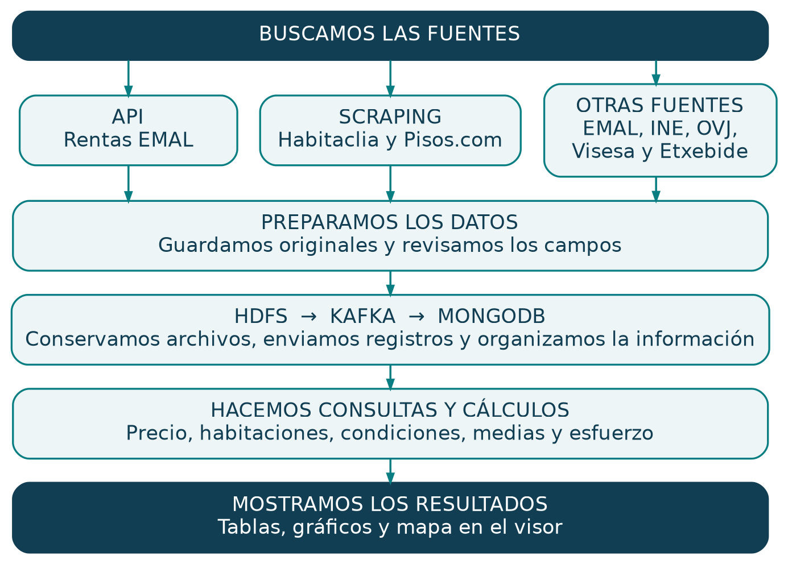
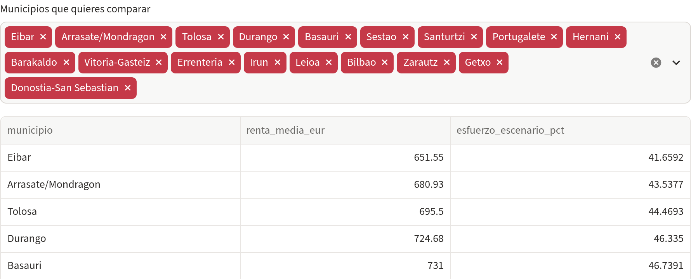
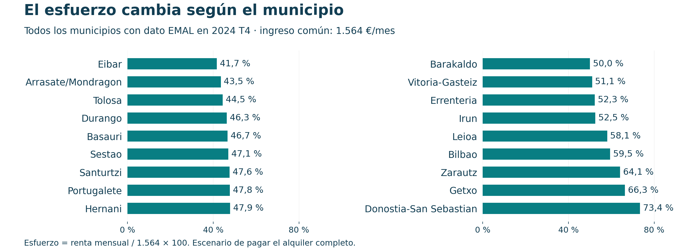
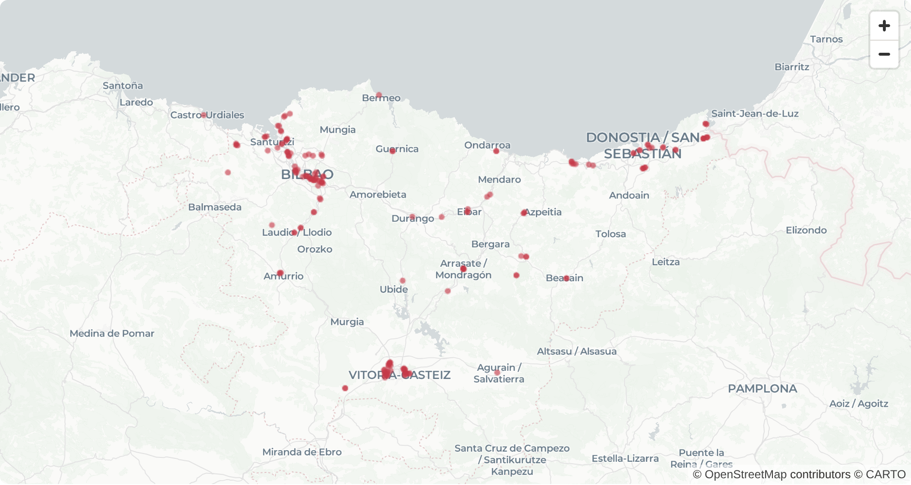

# Documentación BDA y SBD

## 1 Qué queríamos hacer

Queríamos comparar el alquiler en todos los municipios disponibles en nuestras fuentes y entender qué parte de un sueldo joven podría llevarse. La serie EMAL incluye 19 municipios de Euskadi. Buscamos los datos, los organizamos y los mostramos en un visor. Este esquema resume el proyecto.

El esquema es de elaboración propia. Cada conjunto conserva su significado: anuncios, promociones y estadísticas se distinguen durante el análisis. Nuestro objetivo era poder explicar de dónde sale cada resultado y por qué hemos preparado los datos de esa manera.

## 2 Qué fuentes usamos y qué significa cada cifra

| Fuente | Qué aporta y para qué la usamos |
|---|---|
| EMAL, Excel | Serie de 19 municipios; comparamos todos los que tienen datos en cada trimestre |
| API del visor EMAL | Tres estadísticas de renta de 2024 T4, recibidas directamente desde Python |
| Habitaclia y Pisos.com | 17 anuncios para analizar precios pedidos y características |
| Visesa y Etxebide | 621 registros de promociones, para conservar y situar proyectos de vivienda |
| INE | Códigos oficiales para relacionar el mismo municipio entre fuentes |
| OVJ | Salario medio joven de Euskadi de 2024, usado como referencia común |

**Una promoción es un proyecto que puede incluir varias viviendas.** Por ejemplo, un edificio con 30 pisos podría aparecer como una promoción. Tenemos 215 registros de Visesa y 406 de Etxebide, pero no podemos convertir esa suma directamente en un número de pisos.

**621 promociones + 17 anuncios = 638 registros transportados.** Esa cifra comprueba el recorrido de los datos; no son 638 pisos diferentes. Un mismo proyecto o piso podría aparecer en más de una fuente. Las tres estadísticas de la API van aparte. El modelo de IA utiliza estadísticas EMAL, no estos 17 anuncios.

## 3 Cómo hicimos la API y el scraping

**Con la API recibimos datos preparados para un programa.** Hicimos una comprobación con rentas de las capitales para 2024 T4, seleccionando nuevos contratos, vivienda habitual y edificio colectivo. Guardamos la dirección y los filtros. Esta prueba complementa el análisis de todos los municipios disponibles en el Excel EMAL.

La API devuelve 930,3 €/mes para Bilbao, 1.147,5 para Donostia y 798,6 para Vitoria. El Excel incluye más decimales. Comprobarlo nos ayudó a entender que una diferencia pequeña puede deberse al redondeo.

**Con el scraping recogemos los datos del HTML de los listados.** Usamos `requests` para descargarlo y `BeautifulSoup` para encontrar cada anuncio. Extraemos precio, metros cuadrados, habitaciones, baños, ubicación y enlace, y los guardamos en JSON.

Para probar la extracción reunimos una muestra de los dos portales en las capitales. Al principio fallaron algunas rutas y selectores; los corregimos revisando el HTML recibido. Esta muestra sirve para comprobar la recogida y las consultas; el análisis municipal más amplio procede de EMAL.

Comprobamos `robots.txt`, dejamos pausas entre peticiones y detenemos el acceso ante los bloqueos previstos en el código. Tambien guardamos el HTML para revisar la extracción si el anuncio cambia. Las reglas de robots no sustituyen las condiciones de uso del portal.

Las muestras de API y scraping están archivadas desde el 12 de noviembre de 2026. Abrirlas en el visor no supone una nueva búsqueda ni garantiza que los anuncios sigan disponibles.

## 4 Por qué guardamos los originales

Conservamos el archivo recibido, su URL, la fecha y una huella SHA-256 que permite detectar cambios. Separamos los originales de los datos preparados para poder volver atrás si cometemos un error al limpiar.

También distinguimos la fecha de descarga del periodo estadístico. Descargar un archivo en 2026 no convierte sus cifras de 2024 en datos de 2026. Esto importa al comparar alquiler y sueldo: deben referirse a periodos compatibles.

## 5 Para qué usamos HDFS, Kafka y MongoDB

| Herramienta | Qué hace en el proyecto y por qué la usamos |
|---|---|
| HDFS | Guarda originales y procesados. Los recuperamos para comprobar que conservan su contenido |
| Kafka | Un programa envía registros y otro los recibe. Aprendemos a separar la recogida de la carga |
| MongoDB | Organiza los documentos y permite buscar, relacionar y calcular resultados |

Python adapta los formatos de las fuentes y PyMongo comunica nuestros scripts con MongoDB. El visor representa las salidas calculadas, por lo que no tenemos que copiar medias a mano.

En la ejecución conservada recuperamos 31 archivos del lote principal sin cambios y llegaron 638 registros. La API tuvo otro recorrido de seis archivos y tres estadísticas. Con esta muestra pequeña usamos HDFS y Kafka para aprender y comprobar el recorrido del reto; no hemos medido su comportamiento con millones de anuncios.

## 6 Cómo evitamos los duplicados

Si repetimos una carga, el mismo anuncio no debe convertirse en dos documentos. Usamos **fuente e identificador original juntos**: si esa pareja existe, actualizamos su ficha; si no existe, la creamos. Esto se llama `upsert`, y añadimos una restricción para que esa pareja no se repita.

Kafka confirma el mensaje después de guardarlo. Asi evitamos dar por terminada una escritura que ha fallado. Al recargar los 17 anuncios seguimos teniendo **638 documentos**, y la API mantiene **tres**. Este control reconoce el mismo registro de origen, pero todavía no detecta un piso anunciado en dos webs diferentes.

## 7 Por qué organizamos así la base de datos

Una **colección** es un grupo de fichas y cada **documento** es una ficha. Elegimos MongoDB porque las fuentes traen campos distintos: un anuncio puede tener habitaciones y una promoción puede no publicar precio mensual.

**Anuncios y promociones comparten `viviendas`**, la carga y los campos de fuente, identidad y municipio. Guardamos el tipo para distinguirlos. Las consultas de alquiler excluyen promociones para no mezclar unidades distintas.

**Las características van dentro del anuncio.** Agrupamos habitaciones, baños y ascensor en `caracteristicas` porque describen esa misma ficha y normalmente los consultamos juntos. Así podemos buscar, por ejemplo, anuncios con dos habitaciones.

**Los municipios van separados y se relacionan por código INE.** Guardar su contexto una sola vez evita repetirlo. El código permite reconocer nombres como Donostia y San Sebastián.

| Otras colecciones | Por qué las separamos |
|---|---|
| rentas_emal y rentas_api | Distinguir la serie por trimestre de las estadísticas recibidas por API |
| contextos_ovj | Conservar el sueldo autonómico sin presentarlo como salario de cada municipio |
| vistas_municipales | Guardar resultados preparados y su procedencia |
| rechazos_ingesta | Revisar registros que no hemos podido incorporar y conocer el motivo |

Las condiciones publicadas se guardan como una lista, porque un anuncio puede mencionar alquiler temporal y dirigido a empresas a la vez. Después podemos buscar cada señal dentro de esa lista.

## 8 Qué limpiamos antes de consultar

| Limpieza | Para qué la hacemos |
|---|---|
| Duplicados por fuente e identificador | No contar varias veces el mismo registro |
| Datos ausentes como nulos | Distinguir «no lo sabemos» de cero o falso |
| Tipos y formatos comunes | Comparar precios y superficies como números |
| Campos calculados | Obtener precio por m² cuando precio y superficie son positivos |

Si falta el precio, no ponemos cero: parecería que el alquiler es gratuito. Si falta el ascensor, no ponemos falso: no sabemos si tiene. Conservamos el INE con cinco caracteres y dejamos fuera dos referencias ambiguas de Abanto; por eso aceptamos 621 de los 623 registros oficiales.

También comprobamos el CRUD: **crear, leer, actualizar y borrar**. Insertamos una ficha de prueba con precio 600, la leímos, cambiamos el precio a 700 y la borramos, comprobando cada paso. Ese dato de prueba no forma parte del análisis de vivienda.

## 9 Qué consultas hicimos y por qué

Todas las consultas de anuncios excluyen promociones y datos de ejemplo, y exigen un alquiler con precio válido. Estas son las preguntas que hemos probado:

**Consulta 1. Alquileres de Bilbao ordenados por precio.** Queríamos revisar una ciudad y ver primero los anuncios más baratos. Filtramos Bilbao y ordenamos de menor a mayor. Obtuvimos **seis anuncios**.

**Consulta 2. Precio de hasta 750 €/mes.** Sirve para probar una búsqueda por presupuesto. Pedimos un precio positivo y no superior a 750 €: salió **un anuncio en Vitoria**. Para que funcione, el precio debe ser numérico. Es un límite de ejemplo, no una garantía de que alguien pueda pagarlo.

**Consulta 3. Bilbao, hasta 2.000 € y desde 55 m².** Buscamos anuncios que cumplan las tres condiciones a la vez, como haría una persona al combinar ciudad, presupuesto y tamaño. Obtuvimos **cuatro resultados**. Los 2.000 € son el filtro de la prueba, no una recomendación para jóvenes.

**Consulta 4. Al menos dos habitaciones.** Puede ayudar a revisar opciones para compartir. Consultamos el campo dentro de `caracteristicas` y obtuvimos **diez anuncios**, con una salida limitada a diez. Ese límite no permite afirmar que solo diez cumplan la condición.

**Consulta 5. Señales de alquiler temporal.** Buscamos «temporal» en la lista de condiciones para detectar ofertas que podrían no servir como vivienda estable. Aparecieron **tres anuncios**. No encontrar esa palabra tampoco garantiza un alquiler de larga duración.

**Consulta 6. Dos habitaciones y ascensor.** Salieron **cero resultados** porque el campo ascensor no está acreditado en la muestra, aunque algún título lo mencione. Aprendimos que una consulta vacía puede deberse a información que no hemos extraído.

**Consulta 7. Gaztelagun en la lista de programas municipales.** Salieron **cero resultados**: los datos cargados no aportan esa lista con el programa. No demuestra que la ayuda no exista. Necesitamos otra fuente para que esta consulta sea útil.

Las consultas comprueban filtros simples, combinados, campos anidados y listas. Lo importante es revisar si tenemos el dato necesario para responder, además de escribir bien la búsqueda.

## 10 Cómo pasamos de anuncios a resúmenes

Hemos preparado tres **agregaciones**, es decir, recorridos de MongoDB que agrupan y calculan sobre varios documentos:

**Estadísticas por municipio.** Filtramos anuncios válidos y agrupamos por INE para obtener recuento, precios medio, mínimo y máximo, superficie media y media de €/m². Así comparamos ciudades sin revisar los anuncios uno a uno.

**Cruce con el contexto municipal.** Relacionamos anuncios y municipios para calcular qué parte de un sueldo supone el alquiler. En los anuncios de 2026 falta un salario municipal observado y comparable, así que el porcentaje queda vacío. No lo rellenamos con el sueldo autonómico de 2024.

**Distribución y anuncios de menor precio.** Con `facet` preparamos varios resúmenes: tramos de precio, cinco anuncios más baratos y desglose por tipo de operación. Sirve para representar distintas preguntas sobre la misma selección.

Por ejemplo, una consulta devuelve los anuncios de Bilbao. La agregación los resume en una fila con su precio medio, el más barato y el más caro. Después podemos mostrar ese resumen en el visor.

Los pasos principales son filtrar (`$match`), agrupar (`$group`), elegir campos (`$project`), ordenar (`$sort`) y relacionar (`$lookup`). También usamos `$unwind`, `$set`, `$facet` y `$limit`. El análisis EMAL genera por separado comparación municipal, evolución trimestral y resumen territorial, además del mapa de promociones.

## 11 Por qué añadimos un índice

Un índice ayuda a encontrar información sin revisar toda la colección, como el índice de un libro. Lo creamos con municipio, operación y precio porque esos campos aparecen juntos en nuestra búsqueda de alquileres de Bilbao de hasta 2.000 €.

| Comprobación con explain | Sin usar el índice | Usándolo |
|---|---:|---:|
| Documentos examinados | 638 | 4 |
| Resultados encontrados | 4 | 4 |
| Tiempo registrado | 0 ms | 0 ms |

MongoDB revisa menos documentos y devuelve lo mismo. Ambos tiempos son cero: no podemos medir la mejora de velocidad. El informe distingue `COLLSCAN` e `IXSCAN`. También usamos índices para el INE y para impedir identidades duplicadas. Ocupan espacio, así que deben tener una utilidad.

## 12 Cómo comprobamos las actualizaciones simultáneas

Probamos **100 incrementos concurrentes y el contador terminó en 100**. Usamos `find_one_and_update`, `$inc` y `$set` para sumar y actualizar la fecha juntos, sobre un documento. La prueba se hizo en una copia aislada: no representa cien personas interesadas ni cambia los anuncios originales.

Esta actualización es atómica: los cambios del documento se hacen juntos. Para cambiar varias fichas de forma inseparable habría que estudiar una transacción. Hemos aprendido a distinguir esos casos.

## 13 Qué vemos al comparar todos los municipios

La serie EMAL incluye **19 municipios**. En **2024 T4 hay datos de 18**, y comparamos todos ellos. Erandio aparece en la serie histórica, pero no tiene dato en ese trimestre. Es la cobertura de nuestras fuentes, no un censo de todos los municipios de Euskadi.

Usamos **1.564 € netos al mes**, salario medio de jóvenes asalariados de 18 a 34 años de Euskadi en 2024, incluidas las pagas extra. Al mantener ese ingreso fijo vemos cómo cambia el esfuerzo según la renta municipal.

Eibar tiene la menor renta media: **651,55 €** y **41,66 %** del ingreso común. Donostia-San Sebastián tiene la mayor: **1.147,53 €** y **73,37 %**. Son contratos observados, no anuncios actuales.

En Bilbao calculamos `930,31 / 1.564 × 100 = 59,48 %`. Suponemos pagar todo el alquiler con el ingreso común, no con el sueldo real de cada municipio.

Calculamos renta mensual, equivalente anual, contratos, variación interanual y esfuerzo. El 30 % es una referencia de comparación, no un criterio de ayudas. El resumen territorial usa medias simples entre municipios, sin ponderar por contratos.

El visor permite elegir municipios, comparar con barras, ver su evolución y descargar las cifras en CSV.

El mapa incluye todas las promociones Visesa con coordenadas archivadas, también en municipios sin dato de renta. La casilla del visor permite limitarlo a la selección. Aparecer en el mapa no garantiza disponibilidad. Captura del 18 de noviembre con los resultados conservados.

## 14 Qué podemos decir de la muestra de anuncios

| Municipio de la muestra | Precio pedido medio | Media de €/m² |
|---|---:|---:|
| Vitoria-Gasteiz | 1.604,40 € | 16,60 |
| Donostia-San Sebastián | 2.108,33 € | 25,70 |
| Bilbao | 2.316,67 € | 21,36 |

Bilbao tiene el mayor precio medio de esta selección y Donostia la mayor media por m². Son viviendas de tamaños distintos; calculamos primero los €/m² de cada anuncio y luego su media.

**La muestra es pequeña y sirve para probar el funcionamiento.** Un piso caro puede mover bastante la media. Además, hay tres señales de temporalidad y dos de anuncios dirigidos a empresas, que pueden coincidir. Esta muestra permite comprobar el sistema, pero no ordenar todo el mercado de Euskadi. Tampoco debemos mezclar precios pedidos de 2026 con rentas de contratos de 2024.

## 15 Qué hemos aprendido y conclusión

Hemos aprendido a organizar los datos pensando en lo que queremos preguntar. Guardar características dentro del anuncio facilita buscar habitaciones; separar municipios permite relacionar fuentes; y distinguir promociones de anuncios evita confundir lo que estamos contando.

Lo mas importante ha sido revisar los límites: un dato vacío no es cero, una consulta sin resultados no demuestra que algo no exista y repetir una carga no debería duplicar registros. Las comprobaciones nos han ayudado a detectar esas situaciones.

Al comparar todos los municipios con datos en 2024 T4, Eibar tiene la menor renta media y Donostia-San Sebastián la mayor. En todos, pagar la renta completa supera el 40 % del ingreso común elegido. Que un municipio sea más barato no significa que resulte fácil pagarlo. No hemos medido cuántos jóvenes pueden emanciparse.

Hemos conseguido un recorrido que recoge, conserva y consulta datos cuyo origen podemos comprobar. Para mejorarlo ampliaríamos la muestra, revisaríamos pisos repetidos entre portales y completaríamos campos como el ascensor y las ayudas. También buscaríamos ingresos comparables y probaríamos un volumen mayor. Son mejoras pendientes.

## 16 Dónde se puede comprobar

Los resultados proceden de ejecuciones conservadas. Abrirlos para hacer las capturas de esta memoria no repite el transporte ni modifica los datos.

| Parte | Ruta desde la raíz |
|---|---|
| Originales y captura de anuncios | data/capturas_oficiales/ y data/capturas_anuncios/ |
| API monetaria | data/capturas_api_rentas/2026-11-12/ |
| Consultas, índices y comprobaciones | docs/evidencias_entrega_2026-11-12/anuncios/ |
| Comparación municipal y evolución | docs/evidencias_entrega_2026-11-12/municipal/ |
| Código y prueba CRUD | src/database/ e integration_tests/test_mongodb_live.py |
| Copias de HDFS y MongoDB | data/exportaciones_entrega_2026-11-17/ |

En el ZIP se incluyen las instrucciones de ejecución y de restauración en PDF. Las capturas y el esquema de esta memoria tienen su procedencia registrada en `docs/entrega/assets/procedencia_visuales.json`.
