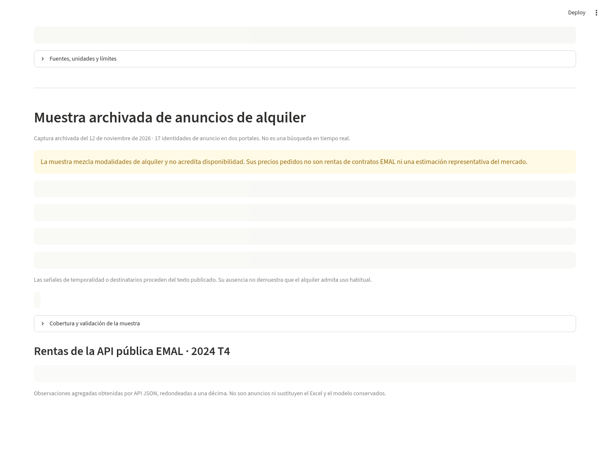
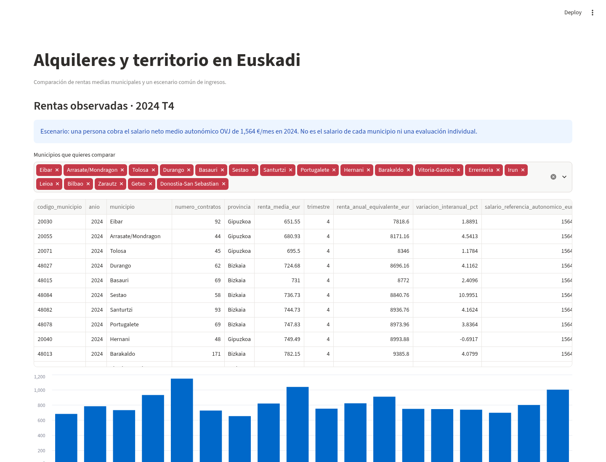

# Documentación BDA y SBD

## 1 La pregunta que queremos responder

Queremos estudiar en qué municipios de Euskadi resulta menos difícil acceder a una vivienda siendo joven. Para acercarnos a esa pregunta necesitamos precios y también un contexto de ingresos. Si solo enseñamos anuncios, sabemos cuánto se pide, pero no qué supone pagarlo. Si solo enseñamos salarios, nos falta el coste de la vivienda.

Hemos construido un recorrido en Python que recoge datos, conserva los originales, los transporta y los analiza con MongoDB. El resultado se puede consultar en un visor territorial. La idea es que podamos seguir una cifra desde el gráfico hasta el archivo del que salió, en vez de pedir que se confíe en una tabla sin más.

Con los datos comparables de 2024 T4, Vitoria-Gasteiz presenta la menor renta media de las tres capitales. Aun así, pagarla entera supone el 51,06 % del salario de referencia que usamos. Esto muestra una dificultad de acceso en ese escenario. No nos permite afirmar qué porcentaje de jóvenes puede emanciparse ni elegir el mejor municipio para cualquier persona.

## 2 Elegimos fuentes que aportan cosas distintas

Necesitábamos combinar información publicada con anuncios concretos. Por eso usamos EMAL para las rentas de contratos, dos portales para precios pedidos, catálogos oficiales para promociones, el INE para identificar municipios y el Observatorio Vasco de la Juventud para el contexto salarial. No damos por hecho que todos esos datos describen lo mismo.

| Fuente | Qué observamos | Para qué nos sirve | Límite principal |
|---|---|---|---|
| EMAL Excel | Municipio y trimestre de nuevos contratos | Comparar rentas y su evolución | Agregados de municipios cubiertos, no pisos individuales |
| API JSON del visor EMAL | Tres estadísticas de 2024 T4 | Acreditar extracción API con importes monetarios | Redondea a una décima |
| Habitaclia y Pisos.com | 17 identidades de anuncio archivadas | Analizar precios pedidos y condiciones publicadas | Selección pequeña y no aleatoria |
| Visesa y Etxebide | 621 registros de promociones aceptados | Situar promociones y conservar su información | No son 621 viviendas disponibles |
| INE | Código municipal oficial | Relacionar fuentes sin depender del nombre | Los nombres ambiguos requieren revisión |
| OVJ | Salario autonómico de 2024 | Construir un escenario común de esfuerzo | No es un salario municipal ni individual |

El lote conjunto tiene 638 registros: 621 promociones y 17 anuncios. Esa suma sirve para comprobar el transporte, no para contar viviendas únicas. Además, las tres estadísticas de la API viajan por separado. Los datos declarados en la aplicación de IA tampoco forman parte de esos 638 registros.

Las promociones aceptadas se reparten en 215 de Visesa y 406 de Etxebide. Puede haber referencias a una misma promoción en ambas fuentes. Entre los anuncios también puede haber un mismo inmueble publicado en dos portales. La identidad que comprobamos es la del registro de cada fuente.

Evidencias: `data/capturas_oficiales/manifest.json`, `data/capturas_anuncios/manifest.json`, `data/capturas_api_rentas/2026-11-12/` y `docs/evidencias_entrega_2026-11-12/anuncios/resumen.json`.

## 3 La API y el scraping se complementan

Con una API recibimos una estructura preparada para que la lea un programa. Usamos el servicio JSON del visor público EMAL, con filtros de municipio, nuevos contratos del trimestre, vivienda habitual y edificio colectivo. Conservamos la URL completa para saber exactamente qué pedimos. No convertimos el Excel a JSON para presentarlo como si fuera una API.

La dirección del servicio es https://eremutentsionatua.euskadi.eus/ad23aConsultaWar/consulta/emal. Las respuestas archivadas para 2024 T4 contienen 798,6 €/mes en Vitoria-Gasteiz, 1.147,5 en Donostia y 930,3 en Bilbao. Son rentas municipales, no anuncios. La diferencia de decimales con el Excel se explica por el redondeo de la API.

Con scraping extraemos información del HTML de los listados. Lo necesitamos porque los anuncios aportan precio pedido, superficie y condiciones que no encontramos como observaciones individuales en EMAL. La captura del 12 de noviembre de 2026 conserva nueve anuncios de Habitaclia y ocho de Pisos.com: seis en Bilbao, seis en Donostia y cinco en Vitoria.

La captura limita a tres candidatos interpretables por listado y portal; en Pisos.com Vitoria solo se obtuvieron dos. Se guardaron robots, HTML y metadatos. Hubo un primer intento con rutas antiguas y selectores que no funcionaban; ese fallo se conserva y no cuenta como captura correcta. El acceso con HTTPS, las pausas y la consulta de robots están registrados. Que robots permita una ruta no significa que conceda derechos de redistribución comercial.

Elegimos conservar el HTML para poder revisar la extracción aunque el anuncio cambie o desaparezca. El análisis offline vuelve a leer los archivos archivados y contrasta sus campos con MongoDB. Esto comprueba lo capturado en esa fecha; no confirma que el anuncio siga disponible hoy.

La captura anterior es evidencia histórica real del visor, no una pantalla creada para esta memoria. La respuesta JSON y su manifiesto son los archivos que permiten comprobar los importes y los filtros exactos.

## 4 Guardamos el origen antes de transformar

Antes de limpiar los datos guardamos los bytes originales. Registramos la URL solicitada y final, fecha UTC, estado HTTP, tamaño y SHA-256. La huella funciona como una comprobación de integridad: si los bytes cambian, ya no coincide. No demuestra por sí sola que una fuente sea correcta; demuestra qué archivo hemos usado.

Separamos originales y procesados porque cumplen funciones distintas. Los originales permiten revisar lo publicado; los procesados facilitan consultar y relacionar. Si una transformación tiene un fallo, podemos corregirla desde el original sin inventar el valor perdido. Los manifiestos se comprueban antes de utilizar las capturas.

Los seis originales oficiales tienen protección frente a cambios automáticos de finales de línea en Git. Es relevante porque un CSV puede verse igual y tener bytes distintos al pasar de Windows a Linux. Esa diferencia rompería su huella aunque el texto pareciera idéntico.

Ejemplo real: `emal_municipios.xlsx` se capturó el 10 de noviembre de 2026. Su SHA-256 es `f4d27d4e8e9bd3688d4e7a454026a4a0884073dc73e3fc1c0da4891a1ad1af5c`. Los anuncios y las respuestas API utilizadas en el cierre son del 12 de noviembre. No mezclamos fecha de captura y periodo estadístico: una captura de 2026 puede contener estadísticas de 2024.

Código y evidencia: `scripts/audit_project.py`, `src/extraction/`, `.gitattributes` y los manifiestos de las tres carpetas de capturas.

## 5 Así recorren los datos el sistema

:::flow Captura y manifiesto | Preparación Python | HDFS y recuperación | Kafka | MongoDB | Visor

Primero verificamos los originales y preparamos los registros. Después guardamos originales y derivados en HDFS. Recuperamos los archivos y comprobamos que coinciden con lo guardado. Publicamos en Kafka los registros recuperados y el consumidor valida cada mensaje antes de persistirlo en MongoDB. Desde ahí calculamos salidas que el visor puede representar.

Usamos HDFS para separar el archivo de origen del procesamiento posterior y demostrar almacenamiento y recuperación. Nos permite organizar rutas raw y processed. Con esta muestra pequeña no necesitamos un clúster por volumen: su uso responde al recorrido de Big Data del reto. No afirmamos haber medido escalado con millones de anuncios.

Kafka separa quien produce los datos de quien los recibe. En vez de que todo dependa de una única llamada, publicamos eventos que el consumidor va procesando. La clave municipal mantiene una organización territorial del flujo. El lote permite distinguir qué mensajes esperamos en una ejecución. No presentamos esta reproducción de un archivo como una fuente inmobiliaria en directo.

MongoDB nos permite guardar documentos con campos comunes y otros que dependen de cada fuente. Por ejemplo, un anuncio puede tener habitaciones y una promoción puede no publicar un precio mensual. Usamos PyMongo para cargar, actualizar, limpiar y consultar sin rellenar huecos con valores inventados. También permite producir indicadores con agregaciones cerca de los datos.

La evidencia del lote conserva 31 archivos recuperados idénticos y 638 registros recibidos y persistidos. La segunda carga completa mantiene 638. La API tiene su propio recorrido: seis archivos por carga y tres documentos en `rentas_api` después de repetir. Las vistas municipales también se transportan aparte, con identidad de archivo y huella.

Código: `scripts/run_pipeline.py`, `src/hdfs/`, `src/kafka/consumer.py`, `scripts/transport_rent_api.py` y `scripts/transport_municipal.py`. Evidencias: carpetas `docs/evidencias_entrega_2026-11-12/` y `docs/evidencias_cierre_rubrica_2026-11-12/`.

## 6 Evitamos duplicar al repetir una entrega

Una carga puede fallar después de escribir un documento y antes de confirmar el mensaje. Por eso no basta con contar cuántos mensajes hemos enviado. Necesitamos que repetirlos no cree otra copia del mismo registro.

En `viviendas` usamos la pareja `fuente` e `id_origen` para actualizar o insertar con upsert. Esa pareja también tiene un índice único parcial. En `municipios` usamos el código INE. El consumidor confirma el offset de Kafka después de la persistencia; si guardar falla, no confirma como si todo hubiera terminado bien.

Esto nos da una entrega que admite repeticiones con persistencia idempotente. No afirmamos que exista una transacción única que abarque Kafka, HDFS y MongoDB. Hay que distinguir la confirmación de un mensaje de la consistencia de todo un sistema distribuido.

La evidencia importante es repetir: la reentrega de los 17 anuncios mantiene los 638 documentos del lote. Repetir la API mantiene tres documentos. Un recuento estable y la comprobación de las identidades nos permiten detectar duplicados. Esta identidad no resuelve que dos portales anuncien el mismo piso con identificadores diferentes.

## 7 Modelamos según lo que representa cada dato

| Colección o estructura | Identidad y relación | Motivo |
|---|---|---|
| viviendas | fuente e id_origen; código INE hacia municipios | Separar identidad del portal y territorio |
| caracteristicas dentro de vivienda | habitaciones, baños, ascensor | Se leen con el anuncio y describen ese mismo registro |
| municipios | código INE único | Compartir contexto sin copiarlo en cada vivienda |
| rentas_emal | Captura, municipio y trimestre | Conservar la versión de la serie estadística |
| contextos_ovj | Contexto autonómico con procedencia | No atribuir un salario local que no medimos |
| rentas_api | Estadística municipal con su procedencia | Mantenerla separada de anuncios y promociones |
| vistas_municipales | Archivo y SHA-256 | Conservar versiones de resultados transportados |
| rechazos_ingesta | Huella del registro y motivo | Revisar rechazos sin perder el origen |

Metemos las características dentro del documento porque normalmente las consultamos junto al anuncio. Referenciamos el municipio por INE porque muchas viviendas comparten territorio. Así evitamos que un cambio de nombre o una variante bilingüe rompa la unión. Estas son las razones técnicas del diseño, no una afirmación de que probáramos todas las bases de datos alternativas.

Un ejemplo reducido de la consulta conservada de Bilbao tiene `id_origen=habitaclia_c0f284f7d936e9e47372d44b`, `precio=1200` y `superficie_m2=87`. Al unirlo con su documento completo comprobamos fuente, INE, URL y procedencia. El nombre del anuncio no se usa como identificador único.

Código: `src/database/data_loader.py`, `src/database/indexes.py` y `src/municipal_analysis.py`.

## 8 Limpiamos sin hacer que los datos parezcan mejores

Necesitábamos que precios, códigos y campos anidados se pudieran comparar. La limpieza aplica cuatro operaciones distintas: elimina duplicados por fuente e identificador, hace explícitos los nulos y ausencias, normaliza tipos y formatos, y calcula campos derivados. Las operaciones se ejecutan con PyMongo y MongoDB desde scripts, sin editar documentos uno a uno a mano.

Convertimos importes y superficies a números cuando el valor lo permite. Si no es una medida válida, conservamos el problema y dejamos nulo el valor utilizable. No convertimos un ascensor desconocido en falso ni una renta ausente en cero. Calculamos precio por metro cuadrado solo cuando precio y superficie son positivos. Las categorías por tramos de precio describen importes; no conceden ayudas.

El código INE mantiene cinco caracteres para no perder el cero inicial de Araba. La preparación oficial acepta 621 de 623 registros y rechaza dos referencias ambiguas de Abanto. Preferimos registrar el rechazo antes que asignar Bilbao por defecto. Esto conserva la posibilidad de revisar el caso.

En la selección de 17 anuncios no hay nulos de precio, superficie, habitaciones o baños. Hay nueve descripciones ausentes de Habitaclia y el ascensor sigue sin dato observado en el campo normalizado. Por eso una consulta que exige ascensor devuelve cero. No significa que los pisos no tengan ascensor: significa que no lo hemos acreditado en ese campo.

El CRUD completo también se comprueba con una prueba separada: insertar un documento de prueba con precio 600, leerlo, actualizar a 700, comprobarlo, eliminarlo y comprobar su ausencia. Está en `integration_tests/test_mongodb_live.py::test_crud_comprobado_real`. Es un dato de prueba identificado, no una vivienda del análisis.

## 9 Las consultas responden preguntas concretas

| Pregunta | Operación que enseñamos | Resultado archivado |
|---|---|---|
| Qué anuncios tenemos de Bilbao | Igualdad, proyección y orden | 6 |
| Cuáles piden hasta 750 €/mes | Comparación de precio positivo | 1 |
| Cuáles cumplen municipio, precio y superficie | Bilbao, hasta 2.000 € y desde 55 m² | 4 |
| Cuáles tienen al menos dos habitaciones | Campo anidado, sin exigir ascensor; límite 10 | 10 |
| Cuáles publican señal temporal | Array de condiciones, operador $all | 3 |
| Cuáles acreditan dos habitaciones y ascensor | Anidado con ascensor observado | 0 |
| Qué municipios traen Gaztelagun en su array | $elemMatch en datos publicados | 0 |

Todas las consultas de anuncios excluyen promociones y registros sintéticos, y exigen precio positivo. Es necesario porque mezclar una promoción sin renta individual con un alquiler daría medias que no significan lo que parecen.

Las primeras cinco filas dan cinco consultas útiles, incluyendo campos anidados, arrays y condiciones combinadas. Los dos ceros también tienen valor: muestran qué no podemos responder con estas fuentes. El resultado limitado a diez no significa que solo existan diez anuncios que cumplan la condición.

Código: `src/database/queries.py`. Resultados completos: `docs/evidencias_entrega_2026-11-12/anuncios/consultas.json`. Los umbrales 750 y 2.000 son filtros de análisis, no umbrales legales de acceso a vivienda.

## 10 Agregamos para pasar de registros a resultados

Una consulta devuelve documentos; una agregación nos ayuda a responder preguntas sobre el conjunto. Hemos preparado tres pipelines en `src/database/aggregations.py`: estadísticas por municipio, cruce con contexto y distribuciones mediante facet. No necesitamos cinco etapas en cada pipeline: la rúbrica pide al menos cinco etapas diferentes en conjunto.

| Pipeline | Pregunta | Etapas principales y lectura |
|---|---|---|
| Estadísticas municipales | Cuánto se pide en nuestra muestra por municipio | $match filtra; $group calcula; $project prepara; $sort ordena |
| Cruce de contexto | Podemos calcular esfuerzo con un salario medido | $lookup une por INE; $unwind conserva ausencia; $set y $project preparan |
| Distribución y top | Cómo se reparte la selección y qué registros cuestan menos | $facet genera salidas distintas; $group, $sort y $limit resumen |

En el cruce de los anuncios de 2026 no rellenamos el salario municipal con el OVJ de 2024. El esfuerzo sigue nulo si falta un salario medido y comparable. La conclusión correcta es que ese cálculo no está respaldado para esos anuncios, no que el esfuerzo sea cero.

El análisis EMAL de 2024 sí usa un escenario común con el OVJ de ese año. `src/municipal_analysis.py` obtiene comparación municipal, serie temporal y resumen territorial mediante MongoDB, además del mapa de promociones y metadatos. Exportamos esas salidas para representarlas sin copiar cifras manualmente.

## 11 Comprobamos el índice sin exagerar el resultado

Creamos un índice compuesto por municipio, tipo de operación y precio porque esos campos aparecen juntos en una consulta frecuente. También hay índices para INE e identidad de registro. Los índices ayudan a localizar documentos, pero tienen coste de espacio y de mantenimiento en las escrituras; no ponemos uno en cada campo sin motivo.

En la consulta de Bilbao, alquiler y precio hasta 2.000 €, comparamos el recorrido natural con el índice. `explain` muestra COLLSCAN sin índice e IXSCAN con él. En ambos casos obtenemos cuatro resultados. Los documentos examinados pasan de 638 a 4.

| Medida | Recorrido natural | Índice compuesto |
|---|---:|---:|
| Documentos examinados | 638 | 4 |
| Resultados devueltos | 4 | 4 |
| Tiempo registrado | 0 ms | 0 ms |

Podemos afirmar que el motor examina menos documentos. No podemos dar un porcentaje de mejora temporal porque los dos tiempos son cero a la resolución de la medición. `mongomock` no sirve para acreditar un plan de ejecución real. El detalle completo se conserva en `docs/evidencias_entrega_2026-11-12/anuncios/explain.json`.

## 12 La atomicidad tiene un alcance concreto

La rúbrica permite justificar que una operación no necesita una transacción multidocumento. En nuestro caso actualizamos un contador y una fecha del mismo documento con `find_one_and_update`, `$inc` y `$set`. MongoDB realiza esa actualización de forma atómica: no necesitamos cambiar el municipio ni otro documento para completar esa operación.

La prueba lanza 100 incrementos concurrentes sobre una copia aislada de un anuncio y obtiene contador 100. No modifica el contador de los anuncios originales y no representa interés real de cien personas. Sirve para mostrar que no se pierden incrementos al coincidir varias operaciones.

Una operación que necesitara modificar dos colecciones de forma inseparable sí requeriría estudiar una transacción. No extendemos la garantía de un documento a todo el recorrido distribuido. Código: `src/database/consistency.py` y `scripts/analyze_rental_sample.py`.

## 13 Qué vemos en la comparación territorial

| Capital en 2024 T4 | Renta media mensual | Contratos | Variación interanual | Esfuerzo del escenario |
|---|---:|---:|---:|---:|
| Vitoria-Gasteiz | 798,57 € | 549 | 2,88 % | 51,06 % |
| Bilbao | 930,31 € | 767 | 6,86 % | 59,48 % |
| Donostia-San Sebastián | 1.147,53 € | 516 | 8,53 % | 73,37 % |

Usamos 1.564 €/mes: salario neto medio de jóvenes asalariados de 18 a 34 años en Euskadi en 2024, incluidas las pagas extra. Dividimos la renta entre ese ingreso y multiplicamos por cien. El escenario supone que una persona paga íntegra la renta media. No describe todos los salarios, hogares o repartos del alquiler.

Calculamos al menos cinco indicadores: renta mensual, equivalente anual, contratos, variación interanual y esfuerzo de escenario; también mostramos la diferencia respecto al 30 %. Este último es un umbral analítico, no un derecho a ayuda. La cobertura de 2024 T4 es de 18 municipios, aunque la serie completa tiene 19. No inventamos el dato ausente para completar la tabla.

Elegimos barras para comparar municipios, una serie para ver evolución y un mapa para ubicar promociones con coordenadas observadas. La tabla permite leer cifras exactas y el CSV permite revisarlas fuera de la app. La media territorial es simple entre municipios cubiertos; no es una media ponderada de todos los contratos de cada provincia.

Esta captura del 11 de noviembre muestra la comparación territorial ejecutada entonces. La sección de anuncios se incorporó después y sus resultados se comprueban en los JSON del 12 de noviembre. No usamos esta pantalla para afirmar que la muestra de anuncios ya estaba en aquella versión.

## 14 Qué aporta la muestra de anuncios

| Municipio | Anuncios | Precio pedido medio | Superficie media | Media de €/m² |
|---|---:|---:|---:|---:|
| Vitoria-Gasteiz | 5 | 1.604,40 €/mes | 95,80 m² | 16,60 |
| Donostia-San Sebastián | 6 | 2.108,33 €/mes | 86,00 m² | 25,70 |
| Bilbao | 6 | 2.316,67 €/mes | 105,50 m² | 21,36 |

En esta selección Bilbao tiene el mayor precio pedido medio y Donostia la mayor media por metro cuadrado. No es una contradicción: son viviendas y superficies distintas. La media de €/m² se calcula promediando el cociente de cada anuncio, no dividiendo las dos medias de la tabla.

Detectamos tres señales textuales de temporalidad y dos de alquiler dirigido a empresas, que pueden solaparse. No detectar esas palabras no acredita vivienda habitual. La mezcla de modalidades y el tamaño de la muestra impiden generalizar el orden de precios a todo el mercado.

Por eso no comparamos estos anuncios de noviembre de 2026 con el salario OVJ de 2024 para decir cuál es asequible hoy. Tampoco mezclamos el precio pedido de una oferta con la renta de un contrato de EMAL. Cada tabla responde una pregunta distinta.

## 15 Qué concluimos y qué mejoraríamos

Con el mismo ingreso de referencia, Vitoria-Gasteiz requiere menos esfuerzo que Bilbao y Donostia en 2024 T4. La conclusión se apoya en rentas EMAL y en un escenario salarial explícito. Las tres capitales superan el 30 % del ingreso de referencia. Por tanto, una renta menor no implica que acceder sea fácil.

El recorrido técnico conserva el origen, permite repetir entregas y produce resultados que podemos explicar y comprobar. Sus límites son la cobertura territorial, la serie revisada, los ingresos agregados y la pequeña selección de anuncios. No hemos medido el impacto del sistema sobre la emancipación.

Como mejoras proponemos una captura periódica con revisión de acceso, mayor cobertura de anuncios, detección de posibles duplicados entre portales, datos de ingresos comparables y seguimiento de calidad por fecha. También sería útil medir rendimiento con un volumen mayor. Estas mejoras no se presentan como funciones ya implementadas.

Para defenderlo mostramos el visor, un original y su manifiesto, el resumen de transporte y la reentrega, las consultas, el explain y la operación atómica. El ZIP incluye una copia recuperada de HDFS y tres exportaciones MongoDB en `data/exportaciones_entrega_2026-11-17/`. Se ha comprobado su restauración en rutas y bases nuevas. El README de esa carpeta explica cómo recuperarlas; el README del paquete explica cómo ejecutar el bloque.

## 16 Dónde comprobamos cada parte

| Afirmación | Archivo que abrimos desde la raíz |
|---|---|
| Fuentes y huellas | data/capturas_oficiales/manifest.json |
| 17 anuncios y composición | docs/evidencias_entrega_2026-11-12/anuncios/resumen.json |
| Consultas y resultados | docs/evidencias_entrega_2026-11-12/anuncios/consultas.json |
| COLLSCAN e IXSCAN | docs/evidencias_entrega_2026-11-12/anuncios/explain.json |
| Tres estadísticas API y reentrega | docs/evidencias_cierre_rubrica_2026-11-12/api-transporte-2.json |
| Indicadores territoriales | docs/evidencias_entrega_2026-11-12/municipal/ |
| Pruebas históricas reales | docs/evidencias_entrega_2026-11-12/integracion-final.xml |
| Datos exportados y restauración verificada | data/exportaciones_entrega_2026-11-17/ |

Las rutas anteriores pertenecen a un único repositorio. Las carpetas académicas comparten código y recursos de la raíz. No las instalamos como proyectos independientes.
