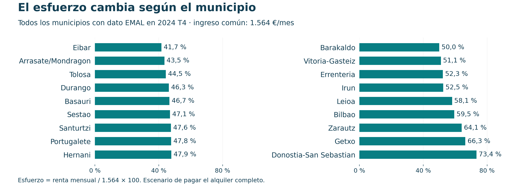
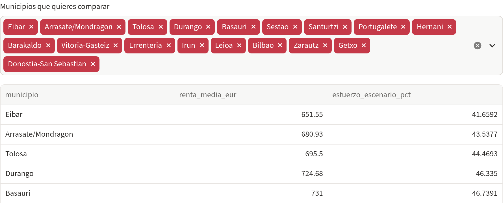
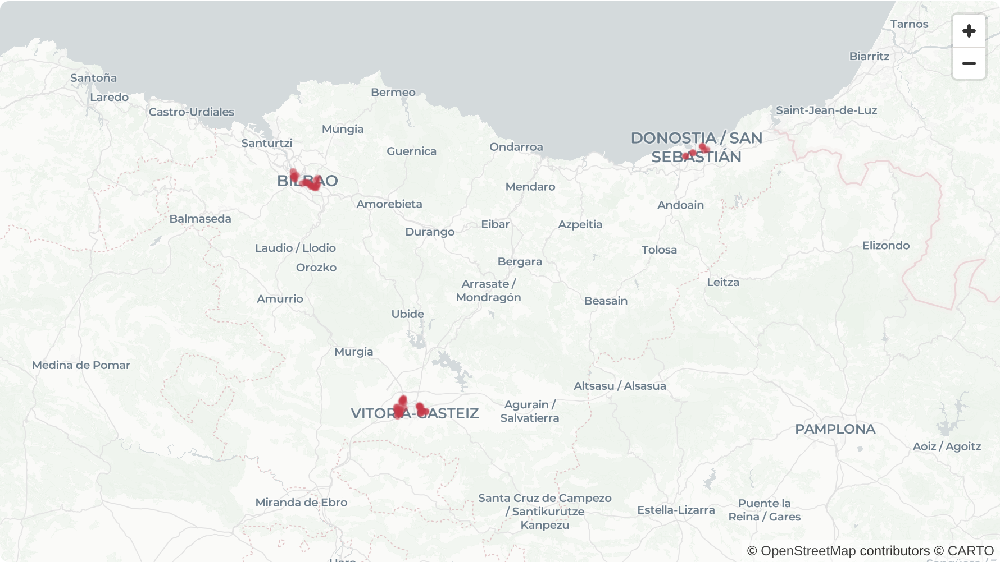

# Presentación BDA y SBD

## 1 ¿Qué supone alquilar siendo joven?

Trabajamos con los 19 municipios de la serie EMAL y comparamos todos los que tienen datos en cada trimestre.

:::flow Recoger datos | Comparar municipios | Entender el esfuerzo

Queremos explicar cuánto cuesta alquilar y qué parte de un ingreso podría llevarse.

## 2 Buscamos datos que se complementen

:::cards Estadísticas :: Rentas de contratos y evolución municipal. | Anuncios :: Precios pedidos y características publicadas. | Ingresos :: Un salario común para comparar.

Juntamos estas fuentes porque el precio, por sí solo, no explica el esfuerzo para pagarlo.

## 3 Cada dato cuenta algo diferente

:::cards 17 :: Identidades de anuncios archivados. | 621 :: Registros de promociones de vivienda. | EMAL :: Serie de rentas de 19 municipios.

Los 638 registros del transporte no son 638 pisos distintos. Analizamos los conjuntos por separado para no mezclar unidades.

## 4 Conservamos el origen de cada cifra

:::flow API y páginas web | Archivo original | Dirección y fecha | Revisión posterior

Guardamos lo que recibimos para poder comprobarlo aunque la web cambie.

Así podemos explicar de dónde sale un resultado y repetir el trabajo.

## 5 Cada herramienta tiene una tarea

:::flow HDFS conserva archivos | Kafka envía registros | MongoDB guarda y consulta

Conectamos las tres herramientas para demostrar el recorrido que pide el reto.

La separación nos permite revisar en qué paso se ha producido un problema.

## 6 Limpiamos sin inventar información

| Qué encontramos | Qué hacemos | Para qué |
|---|---|---|
| El mismo registro otra vez | Actualizamos el que ya existe | Evitar duplicados |
| Municipios escritos distinto | Usamos su código oficial | Relacionarlos bien |
| Ascensor sin información | Lo dejamos como desconocido | No confundirlo con «no tiene» |

Queremos que las comparaciones dependan de los datos, no de errores de formato.

## 7 Convertimos datos en preguntas útiles

:::cards Presupuesto :: ¿Qué anuncios cumplen un precio y una superficie? | Territorio :: ¿Qué municipios tienen menor renta media? | Evolución :: ¿Cómo cambia el alquiler con el tiempo?

Preparamos consultas y resúmenes en MongoDB para que el visor muestre respuestas calculadas.

## 8 Comprobamos que repetir no duplica

:::cards 638 :: Registros después de la primera carga. | 638 :: Registros después de repetirla. | 3 :: Estadísticas de la API, guardadas aparte.

Además, con un índice la misma consulta revisa 4 documentos en vez de 638 y devuelve los mismos resultados.

## 9 Mismo ingreso, distinto esfuerzo

Todos los municipios con dato en 2024 T4. Suponemos pagar la renta completa con un ingreso común de 1.564 €/mes.

## 10 Lo enseñamos en el visor

Podemos comparar todos los municipios o elegir algunos. Aquí se ven la selección completa y las primeras filas de resultados.

## 11 El mapa también necesita contexto

El mapa sitúa promociones publicadas; no garantiza que estén disponibles. Los 17 anuncios tampoco representan todo el mercado.

## 12 Qué hemos conseguido y qué mejoraríamos

:::cards Conseguido :: Comparar todos los municipios disponibles. | Conclusión :: Eibar tiene la menor renta media y Donostia la mayor. | Siguiente paso :: Más muestra e ingresos reales de cada hogar.

En los 18 municipios de 2024 T4, pagar toda la renta supera el 40 % del ingreso común. No cubrimos todos los municipios de Euskadi.
