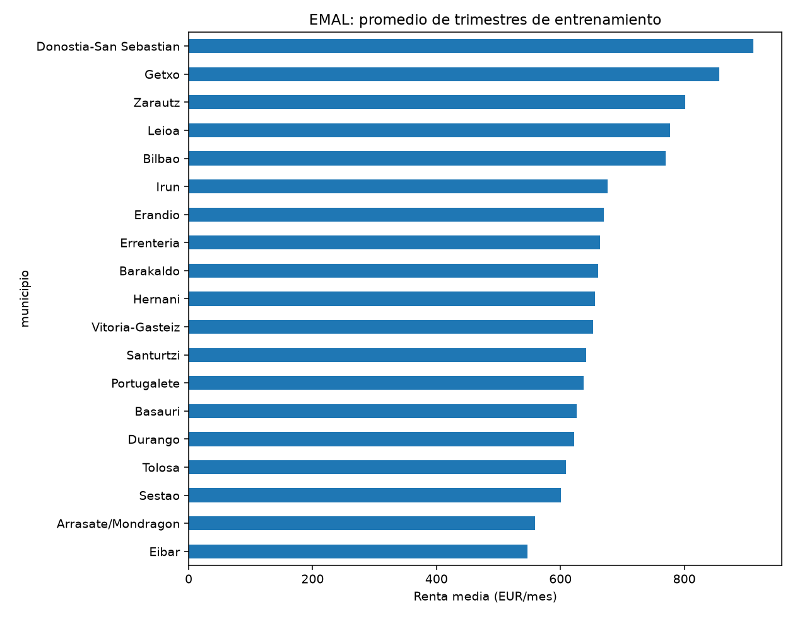
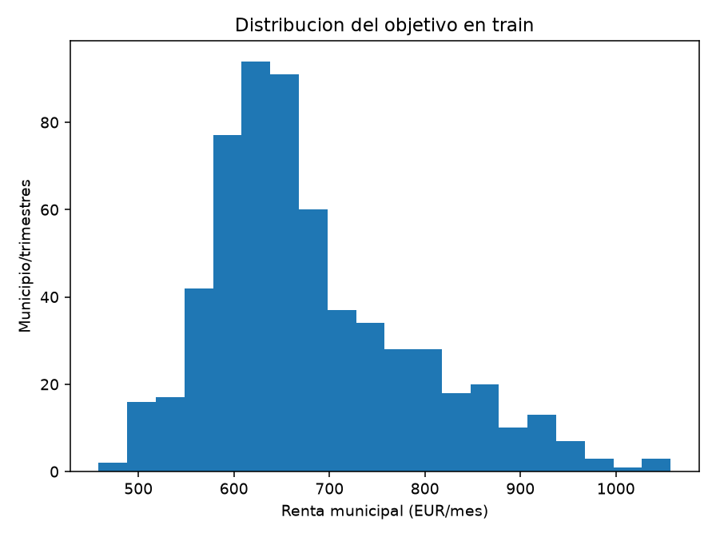
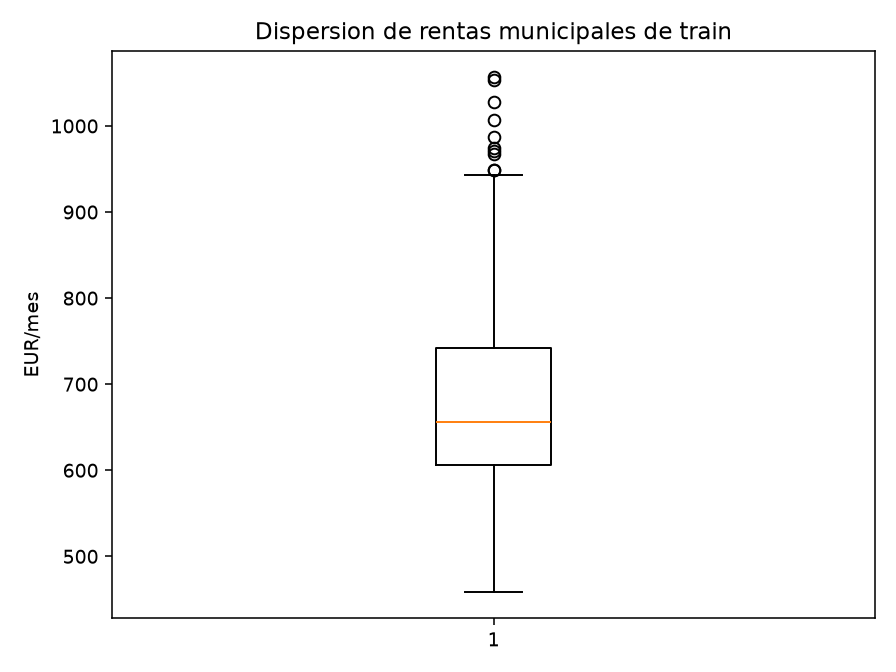
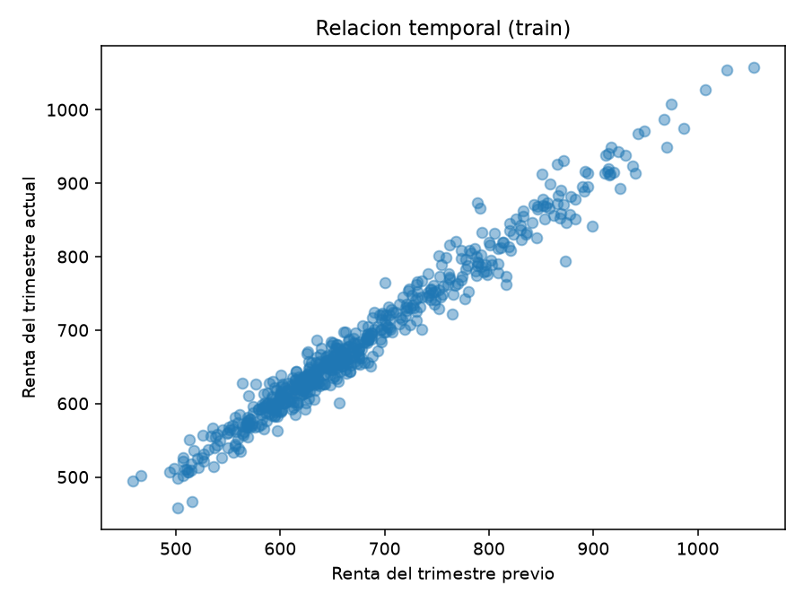
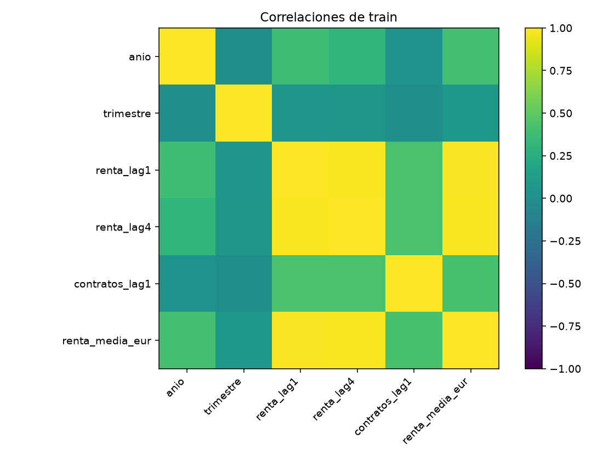
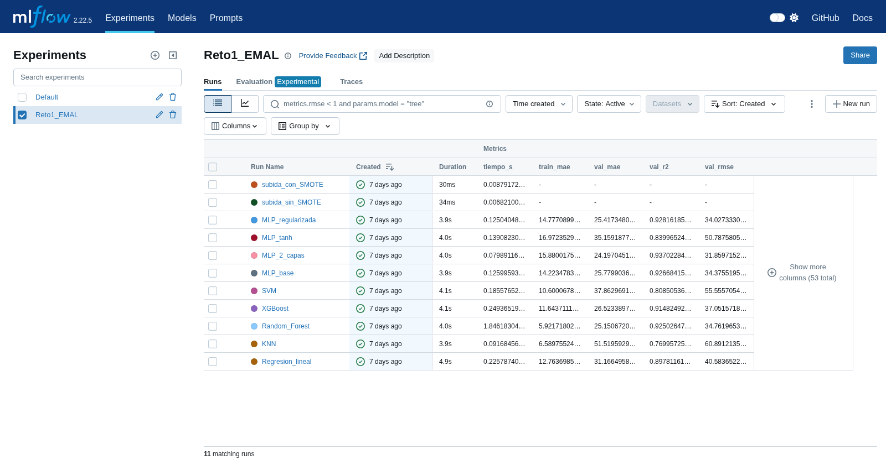
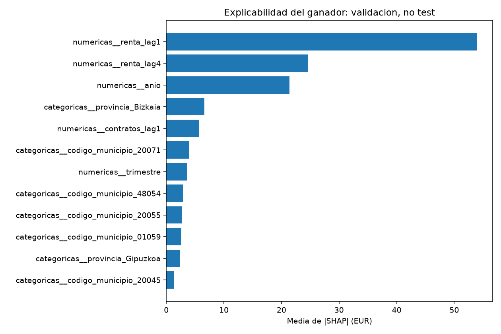
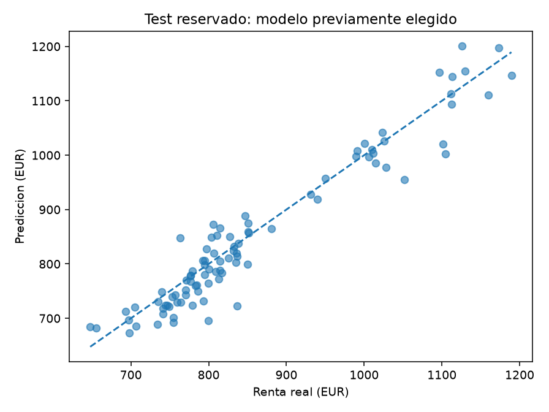
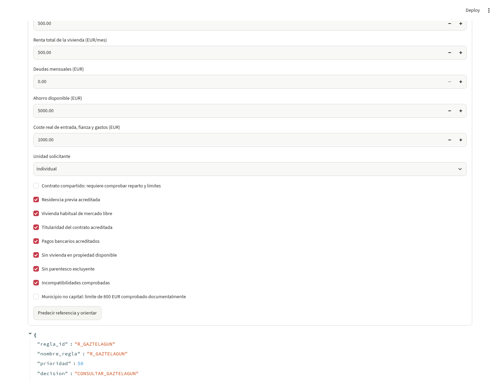

# Documentación SAA PIA y MIA

## 1 Qué problema queremos resolver

Queremos ayudar a un servicio de orientación a explicar qué supone alquilar en distintos municipios de Euskadi. En Bilbao, la renta media de nuevos contratos de EMAL es 930,31 €/mes en 2024 T4. Frente al salario neto autonómico OVJ de 1.564 €/mes en ese año, pagarla entera representa un escenario del 59,48 %. Ese dato nos sirve para situar la dificultad; no describe el sueldo de una persona concreta.

Construimos un sistema que estima una referencia municipal, la muestra en una aplicación y la combina con datos declarados mediante reglas. Si el usuario lo autoriza, se genera una ficha local con n8n. El beneficio esperado es facilitar una comparación que se pueda explicar. No hemos medido una mejora en la emancipación ni un ahorro de tiempo del servicio.

:::flow EMAL | Modelo guardado | Referencia municipal | Reglas y perfil | Consentimiento | n8n y ficha

La predicción es una renta media municipal trimestral, expresada en euros mensuales. No es el precio exacto de un piso, una probabilidad de solvencia ni una decisión administrativa. Mantener esa diferencia es esencial: una media territorial no puede explicar por sí sola las circunstancias de una persona.

Esta memoria describe la versión base 0f990531c86a7b4f247cb80631b02609fed687a0, revisada el 17 de noviembre de 2026. Las métricas, figuras y notebooks ejecutados se leen de los artefactos conservados. No hemos reentrenado, cambiado el ganador ni repetido la evaluación final para preparar estos documentos.

## 2 Por qué es aprendizaje supervisado de regresión

Nuestro modelo aprende a partir de ejemplos históricos que tienen entradas y una renta objetivo observada. Por eso es aprendizaje supervisado. Elegimos regresión porque queremos estimar una cantidad continua en euros. Convertirla en etiquetas como caro o barato perdería información y nos obligaría a fijar límites antes de conocer la situación del usuario.

Es una IA débil porque resuelve una tarea concreta: aprender una relación entre variables de EMAL y su renta media. Una IA fuerte implicaría capacidades generales que este sistema no tiene. En aprendizaje no supervisado buscaríamos grupos o estructuras sin una renta objetivo; no es lo que hacemos en este proyecto.

Usamos pandas para preparar tablas; scikit-learn para transformar variables, comparar modelos y conservar el pipeline; XGBoost para una familia de modelos; matplotlib para el EDA; MLflow para registrar experimentos; SHAP para explicar contribuciones; Streamlit para usar el modelo y n8n para ejecutar la acción local. Cada herramienta tiene una función dentro del recorrido, no es una lista de tecnologías añadidas sin relación.

## 3 Elegimos EMAL porque tiene una unidad clara

Necesitábamos un objetivo observado, comparable y con historia. EMAL publica renta media de nuevos contratos por municipio y trimestre. Usamos las tablas T1.2 de renta y T1.1 de contratos del Excel conservado. No usamos como objetivo los stocks de contratos vigentes actualizados por IRAV, porque responden a otra pregunta.

La captura del 10 de noviembre de 2026 produce 768 observaciones de 19 municipios. La serie supervisada cubre 2016 T1 a 2026 T1. Se excluyen 11 objetivos no publicados y Galdakao por un cambio territorial que haría menos comparable su historia. No rellenamos el objetivo ausente con una media. No usamos los 17 anuncios ni las 621 promociones para entrenar esta regresión.

Una fila representa un municipio en un trimestre, no un contrato individual. Aunque hablamos de trimestre, el importe de la renta es mensual. La fuente cubre municipios publicados en esas tablas, no todos los municipios de Euskadi. Además, es una serie revisada a la fecha de captura: nuestro backtest no reconstruye exactamente qué información estaba disponible en cada fecha histórica.

Evidencia: `entrega_ml/data/procedencia.json`, los tres CSV de particiones y `data/capturas_oficiales/emal_municipios.xlsx`. El manifiesto conserva la URL, los bytes y la huella de la fuente.

## 4 Qué campos tenemos y cuáles entran al modelo

| Campo | Qué significa | Tipo | Nulos train | Uso |
|---|---|---|---:|---|
| codigo_municipio | INE de cinco caracteres | Categórico | 0 % | Entrada |
| municipio | Nombre publicado | Texto | 0 % | Lectura, no entrada |
| provincia | Territorio del INE | Categórico | 0 % | Entrada |
| anio | Año observado | Entero | 0 % | Entrada |
| trimestre | Trimestre observado | Entero | 0 % | Entrada |
| periodo | Año por cuatro más trimestre menos uno | Entero | 0 % | Orden y separación, no entrada |
| renta_media_eur | Renta mensual media del trimestre | Real | 0 % | Objetivo |
| numero_contratos | Contratos del trimestre | Real | 0 % | Origen del retardo, no entrada contemporánea |
| renta_lag1 | Renta un trimestre antes | Real | 4,16 % | Entrada |
| renta_lag4 | Renta cuatro trimestres antes | Real | 13,64 % | Entrada |
| contratos_lag1 | Contratos un trimestre antes | Real | 3,00 % | Entrada |

La tabla completa tiene once campos y siete entradas. Quitamos el nombre del municipio como entrada porque el INE ya identifica el territorio. `periodo` nos sirve para ordenar y partir; no lo añadimos además del año y trimestre. La renta actual es el objetivo: incluirla como entrada sería dar la respuesta al modelo. Los contratos actuales tampoco están disponibles para el trimestre que queremos predecir; usamos su retardo.

Los porcentajes proceden de `entrega_ml/resultados/diccionario.csv`, antes de imputar. El cero de nulos en el objetivo corresponde al conjunto ya filtrado, no significa que el Excel no tuviera valores sin publicar.

## 5 Tratamos los nulos según su origen

En EMAL un guion no significa alquiler de cero euros. Puede indicar que no se publica el dato o que no hay oferta suficiente. Además, los primeros retardos de cada municipio faltan porque todavía no hay historia previa. Por tanto, no suponemos que los nulos aparezcan al azar.

Construimos los retardos antes de quitar los objetivos ausentes. Así, lag1 sigue siendo el trimestre anterior y no la última fila disponible aunque hayan pasado varios trimestres. El código comprueba la continuidad temporal y que no haya claves municipio-trimestre duplicadas.

El objetivo no se imputa: quitamos las filas sin una renta objetivo válida. En las entradas numéricas usamos la mediana ajustada con entrenamiento y, dentro de la validación cruzada, con el entrenamiento de cada fold. Es una solución sencilla que permite conservar los primeros periodos; no recupera la información que falta. En las categóricas usamos la categoría más frecuente, aunque en el train conservado no hay nulos en esos campos.

Las variables nuevas son los retardos de uno y cuatro trimestres y los contratos previos. Nos permiten recoger continuidad y una referencia anual sin usar la renta del trimestre que estamos intentando estimar. Código: `src/ml_data.py` y `src/pipeline.py`.

## 6 Qué aprendemos al mirar los gráficos

Hacemos el EDA con entrenamiento para que el test no influya en nuestras decisiones. Los cinco gráficos originales se conservan con sus comentarios. No quitamos un valor alto solo porque sobresalga: puede reflejar una diferencia real entre municipios.

Las barras comparan medias de agregados trimestrales del train. Donostia tiene la mayor, 911,58 €/mes. Esto nos indica que el territorio aporta información y justifica incluirlo como variable. No son medias ponderadas por todos los contratos ni precios de anuncios individuales.

El histograma muestra cómo se reparten las rentas municipales del entrenamiento. La mediana es 656,00 €. Nos ayuda a entender la escala del error en euros; no usamos ese valor como umbral universal de acceso.

El boxplot resume dispersión y valores extremos. El rango intercuartílico es 136,13 €. La variación territorial existe y no hay motivo para borrar automáticamente las rentas altas como si fueran errores.

La relación entre renta del trimestre previo y actual es muy fuerte: correlación 0,985 en train. Esto nos obliga a comparar con persistencia, que simplemente utiliza la renta anterior. Si un modelo complejo apenas mejora esa referencia, debemos decirlo aunque tenga un R² alto.

El mapa de correlaciones permite ver relaciones entre variables numéricas. Los retardos recogen buena parte de la persistencia. Una correlación no demuestra causalidad ni justifica introducir el propio objetivo entre las entradas.

## 7 Separamos el tiempo antes de comparar modelos

| Conjunto | Periodo | Filas | Para qué lo usamos |
|---|---|---:|---|
| Entrenamiento | Hasta 2023 | 601 | Ajustar transformaciones y modelos |
| Validación | 2024 | 75 | Comparar modelos y cerrar la selección |
| Test | 2025 T1 a 2026 T1 | 92 | Evaluación final única del elegido |

No hacemos una partición aleatoria porque mezclaría pasado y futuro. Dentro del train usamos tres folds temporales de ventana creciente cuando buscamos hiperparámetros. Partimos por trimestres completos para que un mismo trimestre no quede repartido entre entrenamiento y validación del fold.

Esto evita que el modelo vea el futuro en el ajuste. También ajustamos imputación, escalado y codificación dentro del pipeline. No calculamos una mediana con todos los datos antes de partir, porque entonces la información de validación o test entraría en el entrenamiento.

El backtest usa retardos observados. Para predecir cada trimestre contamos con observaciones previas de la serie revisada. No es una predicción autónoma de varios trimestres sin recibir datos intermedios. Esta diferencia limita lo que podemos prometer sobre el uso futuro.

Código: `temporal_split` y `temporal_folds` en `src/ml_data.py`. Las tres particiones originales se conservan en `entrega_ml/data/`.

## 8 Guardamos el preprocesado junto al modelo

:::flow Campos originales | Imputación por rama | Escalado y codificación | Regresor | Euros mensuales

Las variables numéricas pasan por imputación de mediana y StandardScaler. Escalamos para que las unidades de renta no dominen a otras entradas, algo especialmente relevante para KNN, SVM y MLP. Las categóricas pasan por imputación y OneHotEncoder, que crea columnas de categoría sin inventar una distancia numérica entre municipios.

`ColumnTransformer` aplica cada rama y `Pipeline` las une al modelo. Todos los modelos usan esa misma estructura. Los árboles no dependen del escalado del mismo modo, pero mantener un tratamiento común hace más clara la comparación y evita preparar datos distintos por descuido.

El regresor está dentro de `TransformedTargetRegressor`, que escala el objetivo durante el ajuste y devuelve la predicción en euros. Guardamos el pipeline completo en `best_model.joblib`. Así Streamlit aplica las mismas transformaciones aprendidas; no volvemos a calcular medias con el caso del usuario.

La codificación tolera categorías desconocidas, pero eso no demuestra que el modelo sea fiable fuera de cobertura. La aplicación limita los municipios y comprueba que exista renta previa. La estabilidad técnica al transformar un dato y la validez de una predicción son cosas diferentes.

## 9 Qué modelos comparamos y por qué

La regresión lineal nos da una referencia sencilla de relaciones aditivas. KNN predice usando observaciones cercanas y permite comprobar si la similitud entre ejemplos basta. Random Forest combina árboles y puede recoger relaciones no lineales. XGBoost construye árboles de forma progresiva para corregir errores. SVM busca una función de regresión con margen y sensibilidad a su regularización.

No afirmamos que todas las familias necesiten la misma búsqueda. El código usa GridSearchCV temporal para KNN, Random Forest, XGBoost y SVM. Los MLP y la regresión lineal se ajustan con las configuraciones declaradas. Los tiempos y métricas son los registrados en el entrenamiento histórico, no mediciones nuevas de esta memoria.

| Modelo | MAE train | RMSE train | R² train | MAE val | RMSE val | R² val | Segundos |
|---|---:|---:|---:|---:|---:|---:|---:|
| MLP dos capas | 15,88 | 22,35 | 0,9558 | 24,20 | 31,86 | 0,9370 | 0,0799 |
| Random Forest | 5,92 | 9,10 | 0,9927 | 25,15 | 34,76 | 0,9250 | 1,8462 |
| MLP regularizada | 14,78 | 21,22 | 0,9601 | 25,42 | 34,03 | 0,9282 | 0,1250 |
| MLP base | 14,22 | 19,84 | 0,9652 | 25,78 | 34,38 | 0,9267 | 0,1260 |
| XGBoost | 11,64 | 16,31 | 0,9765 | 26,52 | 37,05 | 0,9148 | 0,2494 |
| Regresión lineal | 12,76 | 16,67 | 0,9754 | 31,17 | 40,58 | 0,8978 | 0,2258 |
| MLP tanh | 16,97 | 23,44 | 0,9514 | 35,16 | 50,79 | 0,8400 | 0,1391 |
| SVM | 10,60 | 16,59 | 0,9757 | 37,86 | 55,56 | 0,8085 | 0,1856 |
| KNN | ≈0 | ≈0 | ≈1 | 51,52 | 60,89 | 0,7700 | 0,0917 |

La tabla se transcribe de `entrega_ml/resultados/comparativa_mlflow.csv`. KNN tiene un error casi nulo en train y el peor en validación: encajar muy bien los ejemplos conocidos no garantiza generalizar. Los tiempos dependen del entorno histórico y no son una prueba de rendimiento de producción.

## 10 Los cuatro experimentos MLP tienen una pregunta

| Experimento | Configuración relevante | Qué queremos comprobar |
|---|---|---|
| Base | Una capa de 32 neuronas, ReLU | Tener una referencia de red sencilla |
| Dos capas | 64 y 32 neuronas, ReLU | Si más capacidad recoge relaciones útiles |
| tanh | Una capa de 32, activación tanh | Qué cambia al variar la activación |
| Regularizada | Una capa de 32, alpha 0,01 | Si penalizar más los pesos ayuda a generalizar |

Los cuatro usan MLPRegressor de sklearn, semilla 42 y un máximo de 1.000 iteraciones. En base, dos capas y tanh se conserva el alpha por defecto de 0,0001. ReLU y tanh transforman de forma distinta las señales internas de la red; la regularización limita el tamaño de los pesos. Estas son las razones técnicas para comparar esas configuraciones, no recuerdos inventados del proceso del equipo.

Dos capas obtiene el menor MAE de validación, 24,20 €, frente a 25,78 de la base. La variante tanh queda en 35,16 y la regularizada en 25,42. No suponemos que añadir neuronas siempre mejore; aquí comparamos con la misma partición para poder comprobarlo. Código: `regression_models` en `src/ml_models.py`.

## 11 Elegimos con validación y miramos la referencia sencilla

Usamos MAE como métrica principal porque se interpreta directamente en euros de renta media. El criterio de selección prefiere la regresión lineal si queda dentro del 1 % del mejor MAE. En esta comparación no ocurre, así que conservamos MLP de dos capas.

Pero el baseline de persistencia obtiene MAE 24,63 € en validación. El ganador obtiene 24,20 €, una mejora aproximada de 0,43 €, alrededor del 1,74 %. La validación conservada tiene renta previa para sus 75 filas, de modo que esta comparación comparte cobertura. Una diferencia tan pequeña no demuestra una superioridad general ni una mejora social.

RMSE penaliza más los errores grandes. R² compara el error cuadrático con una referencia de media; no es el porcentaje de predicciones acertadas. Podemos tener R² alto porque la renta cambia bastante entre municipios y, al mismo tiempo, mejorar muy poco respecto a copiar el trimestre anterior.

Para el servicio de orientación esto significa que ofrecemos una referencia aproximada. Un MAE de 24 € no garantiza que cada caso esté dentro de 24 €. Tampoco es el error de estimar un piso individual. No hemos generado intervalos de predicción que permitan prometer un margen para cada caso.

## 12 MLflow deja rastro de las comparaciones

Necesitábamos poder enseñar de dónde sale el ganador y con qué configuración se entrenó. MLflow guarda nombres de experimento, hiperparámetros, métricas, tiempos y artefactos. La tabla de comparación se obtiene consultando esos registros, no escribiendo métricas elegidas a mano.

La captura se tomó el 17 de noviembre de 2026 al abrir una copia de la base SQLite conservada, sin volver a entrenar. Muestra los experimentos históricos, no experimentos nuevos. La imagen anterior de `docs/evidencias_ml/capturas/` se conserva como histórica, pero mostraba la interfaz cargando y no permitía leer la comparación. El identificador del ganador es `bcc44862768c4488ac8a04b41ece5efa`. La base SQLite y los artefactos están en `entrega_ml/mlruns/`. Al trasladarlos a otra máquina algunas rutas de artefactos pueden necesitar adaptación; el modelo completo de inferencia está guardado también de forma independiente en `entrega_ml/models/`.

No necesitamos abrir un entrenamiento para demostrar MLflow. Podemos enseñar la captura y la tabla conservada, y abrir la interfaz con `uv run --no-sync mlflow ui --backend-store-uri sqlite:///entrega_ml/mlruns/mlflow.db --port 5000` desde la raíz. Esa orden abre el registro; no selecciona otro modelo.

## 13 SHAP explica la predicción sin convertirla en una causa

Calculamos SHAP sobre 30 filas de validación con un fondo de 30 filas de entrenamiento y algoritmo permutation. Trabaja con el modelo elegido y devuelve contribuciones expresadas en euros. No usamos test para decidir qué variables explicar.

Las mayores contribuciones absolutas medias conservadas son renta_lag1, 53,97 €, renta_lag4, 24,66 €, y año, 21,40 €. Esto encaja con la persistencia que ya vimos en el EDA. Una contribución absoluta media mide importancia en esa muestra: no significa que subir esa variable cause exactamente ese aumento ni indica por sí sola el sentido del efecto en todos los casos.

Las variables están correlacionadas y la muestra es pequeña, así que la atribución depende del fondo y del método. Enseñamos `shap_metadatos.json` y `shap_validacion.csv` junto al gráfico para que se entienda qué se calculó y sobre qué datos.

## 14 SMOTE es un experimento auxiliar separado

La renta es continua, por lo que no tiene sentido balancearla con SMOTE como si fueran clases. Para estudiar la técnica hacemos otra pregunta: si la renta observada sube respecto al trimestre anterior. Es una clasificación auxiliar con regresión logística y variables numéricas. No clasifica personas ni elegibilidad.

En train hay 357 subidas y 219 no subidas después de exigir renta previa. Comparamos una versión sin SMOTE y otra con SMOTE dentro del pipeline de ajuste. Validación conserva su distribución original. No alteramos el test de la regresión.

| Métrica de validación auxiliar | Sin SMOTE | Con SMOTE |
|---|---:|---:|
| Accuracy | 0,7067 | 0,7067 |
| Precisión | 0,7123 | 0,7313 |
| Recall | 0,9811 | 0,9245 |
| F1 | 0,8254 | 0,8167 |
| Matriz TN / FP / FN / TP | 1 / 21 / 1 / 52 | 4 / 18 / 4 / 49 |

Con SMOTE mejora la precisión y se detectan más no subidas, pero baja el recall y el F1. Por eso no decimos que balancear siempre mejora. Conservamos este resultado aunque no sea el más llamativo. Fuente: `entrega_ml/resultados/comparacion_smote.json`.

## 15 El test final ya está cerrado

Después de cerrar la selección se evaluó el ganador una sola vez en Streamlit. El informe conserva 92 observaciones, MAE 28,67 €, RMSE 37,93 € y R² 0,9189. En el gráfico, cuanto más cerca queda un punto de la diagonal, más parecidos son valor real y predicho. La dispersión muestra que siguen existiendo errores.

MAE resume la magnitud media del error absoluto. Que RMSE sea mayor indica que los errores grandes pesan en la evaluación. El R² describe ajuste sobre estos agregados; 0,9189 no significa 91,89 % de aciertos, y tampoco valida una decisión sobre personas.

La aplicación verifica las huellas del modelo y test y reutiliza el informe ya escrito. `selection.json` conserva `test_evaluado=false` del momento de selección: el estado final está en `resultados/test_final.json` y `docs/TEST_FINAL_EMAL.json`, que registra `evaluaciones=1`. Leer ese campo histórico aislado llevaría a una conclusión incorrecta.

La generación de esta memoria lee el informe y la figura existentes. No vuelve a predecir test ni lo usa para cambiar parámetros. El modelo tiene SHA-256 `d6f05d11fa6002de53ecaff671b697bd901f63f946b87cc7484701aea76c210a` y el test `f1520fc0580fee119b031252538961e5d62eee68db6a0783c3a5384bc5a65011`.

## 16 Cómo usamos el modelo en Streamlit

La app carga `best_model.joblib`, la selección y los resultados. En Modelos y datos se ve la comparación, el EDA, SHAP y SMOTE. En Test reservado se muestra el informe final existente. En Nuevo caso y accion se elige un municipio y se introducen datos declarados.

Para el caso nuevo, la app toma el periodo siguiente al máximo conservado. Con esta captura la referencia es 2026 T2. Construye los retardos con el historial y muestra el periodo para que no parezca una tasación actual de noviembre de 2026. Poder abrir hoy la app no hace que la información del modelo se actualice sola.

La predicción municipal se calcula con territorio, tiempo y retardos. Edad, salario o deudas no entran al modelo EMAL. Se utilizan después en reglas explícitas. Separarlo permite explicar qué ha aprendido el modelo y qué criterio hemos programado nosotros.

Si un municipio no tiene una renta previa válida, la seguridad pide revisión. Una referencia calculada con una imputación no debe presentarse como una cobertura demostrada. Código: `app/streamlit_app.py` y `src/reglas.py`.

## 17 Dos esfuerzos que no debemos confundir

El esfuerzo declarado se calcula como `(alquiler declarado + deudas mensuales) / ingreso neto mensual × 100`. Describe los importes que introduce el usuario. El esfuerzo de referencia es `renta municipal predicha / ingreso neto mensual × 100`. Es un escenario en el que pagaría íntegra esa referencia, sin sustituir su contrato.

Ejemplo ficticio: una persona declara 1.500 € de ingreso, 500 € de alquiler y cero deudas. Su esfuerzo declarado es 33,33 %. Si probamos una referencia de 600 €, el esfuerzo de referencia es 40 %. Si probamos 1.600 €, es 106,67 %. El contrato declarado sigue siendo el mismo.

La regla R_REFERENCIA, prioridad 65, recomienda comparar alternativas cuando el segundo esfuerzo supera el 40 %, siempre que no se haya activado antes otra regla. Las referencias 600 y 1.600 de este ejemplo son entradas de una prueba contrafactual, no predicciones nuevas del modelo.

## 18 Las reglas explican por qué cambia la orientación

| Regla | Prioridad | Cuándo interviene | Decisión |
|---|---:|---|---|
| R_SEGURIDAD | 100 | Datos imposibles, incompletos o fuera de cobertura | Revisar datos |
| R_NORMA | 95 | Fecha fuera de 2026 | Revisar convocatoria |
| R_ESFUERZO_CRITICO | 90 | Esfuerzo declarado mayor del 70 % | Orientación prioritaria |
| R_REQUISITOS | 80 | Requisito básico declarado no cumplido | Revisar requisitos |
| R_DOCUMENTACION | 75 | Comprobaciones incompletas o límite pendiente | Revisión normativa |
| R_ALTERNATIVAS | 70 | Esfuerzo declarado mayor del 40 % | Buscar alternativas |
| R_REFERENCIA | 65 | Esfuerzo de referencia mayor del 40 % | Buscar alternativas |
| R_ENTRADA | 60 | Ahorro menor que coste de entrada | Planificar entrada |
| R_GAZTELAGUN | 50 | Esfuerzo declarado mayor del 30 %, tras filtros anteriores | Consultar Gaztelagun |
| R_GENERAL | 0 | Sin alertas previas | Información general |

Aplicamos la primera regla que cumpla su condición, en orden de prioridad. Así un dato inválido no queda oculto detrás de una recomendación de presupuesto. Diez reglas producen ocho decisiones distintas; varias reglas pueden compartir una rama de n8n.

Los umbrales de esfuerzo son criterios internos de orientación. Las comprobaciones normativas están parametrizadas con una convocatoria de 2026 y su enlace en `src/reglas.py`. El ingreso anual computable se pide aparte del neto mensual: no lo sustituimos por el salario multiplicado por doce. La revisión humana sigue siendo necesaria y ninguna rama concede o deniega una ayuda.

## 19 El consentimiento termina en una acción comprobable

Necesitábamos que una decisión tuviera una utilidad visible. Tras consentimiento, el cliente envía a n8n el UUID del evento, la decisión, la regla, la referencia y datos de origen y versión. No envía nombre, dirección, salario ni el perfil completo.

El workflow `n8n/flujo.json` recibe el webhook y deriva a una rama por cada una de las ocho decisiones. El receptor de `scripts/action_server.py` genera una ficha de alternativas, plan de entrada, checklist o ficha informativa según corresponda. Son archivos locales, no SMS reales, reservas confirmadas ni trámites públicos.

No basta con recibir un HTTP 200: el cliente exige confirmación de persistencia. La ficha guarda el evento y una huella del contenido. Repetir el mismo UUID con el mismo contenido devuelve el registro existente; si cambia el contenido se rechaza. Crear otro caso en el formulario genera un UUID nuevo, así que no sirve para demostrar la repetición del mismo evento.

`data/acciones_n8n/` queda fuera de Git. La persistencia e idempotencia se comprobaron en las evidencias históricas con n8n real y ocho ramas. La configuración es una demostración local; el bloqueo de escritura usa un lock de proceso y no acredita coordinación entre muchos servidores.

La captura muestra el uso real de la aplicación con un perfil inventado. El registro de ese recorrido está en `docs/evidencias_cierre_rubrica_2026-11-12/app-n8n.json`. No es un expediente personal.

## 20 Caso ficticio para ensayar

Elegimos Bilbao. Introducimos 25 años, ingreso neto 1.500 €/mes, ingreso anual computable 18.000 €, pago de alquiler 500 €, renta total de vivienda 500 €, deudas 0 €, ahorro 2.000 € y coste de entrada 1.000 €. Seleccionamos unidad individual y contrato no compartido. Marcamos las siete comprobaciones documentales como verdaderas solo porque es un caso de prueba definido así.

Pulsamos Predecir referencia y orientar. Leemos la referencia y el periodo que realmente muestra la app. El esfuerzo declarado será 33,33 %. No prometemos una cifra exacta de predicción en esta memoria: la leemos del modelo guardado en la demostración. Si la referencia supera 600 €, R_REFERENCIA podrá recomendar alternativas, después de comprobar las prioridades superiores.

Mostramos la regla, su motivo y los dos esfuerzos. Después damos consentimiento, registramos la acción y abrimos la ficha JSON. Volvemos a pulsar Registrar accion sin enviar otro formulario y comprobamos que conserva el mismo evento y no crea otra ficha. Si falla el servicio mostramos la evidencia conservada con su fecha y explicamos que no es una ejecución en directo.

## 21 Relación con clase y mejoras posibles

Las prácticas de redes aportadas usan Keras con Sequential, Dense y Adam. Nuestro modelo usa MLPRegressor de sklearn. Comparten la idea de red multicapa, pero no son la misma API. En transporte usamos kafka-python-ng y REST WebHDFS, frente a confluent_kafka e InsecureClient de los ejercicios. Explicamos la diferencia sin atribuirnos una implementación que no tenemos.

TimeSeriesSplit ya aparece en el material de validación de clase. SHAP de validación y el experimento auxiliar SMOTE amplían los ejercicios revisados, pero solo el profesorado puede confirmar si cumplen los indicadores de novedad de todo el curso. No garantizamos una nota por incluirlos. El F1 auxiliar con SMOTE baja y debemos poder defenderlo.

Como mejoras planteamos actualizar la captura con versiones separadas, estudiar estabilidad por municipio, comparar con más baselines e incorporar intervalos de predicción. Después de haber visto test, una nueva selección necesitaría otro protocolo y otra reserva temporal. No hacemos esos cambios para mejorar ahora la entrega.

La defensa IA dura 15 minutos por pareja y se corta al llegar al límite. Después cada persona responde tres preguntas individuales, una por asignatura. Ambos debemos comprender el recorrido completo, aunque repartamos las diapositivas. La guía y el guion separado indican qué abrir y qué explicar.

## 22 Archivos que sostienen esta memoria

| Parte | Archivo o carpeta desde la raíz |
|---|---|
| Datos y cobertura | entrega_ml/data/procedencia.json y train.csv, val.csv, test.csv |
| Variables y tiempo | src/ml_data.py |
| Preprocesado | src/pipeline.py |
| Modelos y ajuste histórico | src/ml_models.py y src/ml_workflow.py |
| EDA y explicaciones | entrega_ml/resultados/ y notebooks ejecutados |
| Experimentos | entrega_ml/mlruns/ y resultados/comparativa_mlflow.csv |
| Modelo y selección | entrega_ml/models/ |
| Test único | docs/TEST_FINAL_EMAL.json y entrega_ml/resultados/test_final.json |
| Predicción y reglas | app/streamlit_app.py y src/reglas.py |
| Acción y persistencia | src/n8n.py, n8n/ y scripts/action_server.py |

Los formatos funcionales se entregan junto a los PDF; no los convertimos en PDF para reemplazarlos.
