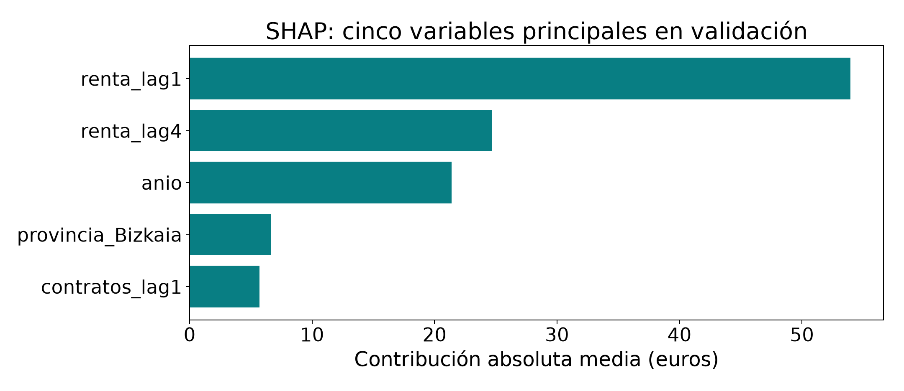

# Presentación SAA PIA y MIA

## 1 Una referencia para orientar

Predecimos renta media municipal, expresada en €/mes.

Ayudamos a comparar opciones; no valoramos un piso ni decidimos ayudas.

:::flow Modelo | Referencia | Reglas | Consentimiento | Ficha local

## 2 Entrenamos con municipios y trimestres

768 observaciones de 19 municipios; no son 768 pisos.

:::flow Train 601 hasta 2023 | Validación 75 de 2024 | Test 92 desde 2025

Fuente EMAL. Objetivo continuo: aprendizaje supervisado de regresión.

## 3 El EDA nos obliga a mirar la persistencia

Correlación 0,985. Comparamos con usar la renta anterior como predicción.

## 4 El pipeline evita preparar cada caso de otra manera

:::flow Imputar en train | Escalar y codificar | Modelo | Euros

Retardos de 1 y 4 trimestres. Nunca introducimos la renta actual.

Guardamos el pipeline completo; MLflow conserva experimentos y métricas.

## 5 Comparamos cinco familias y cuatro MLP

Lineal, KNN, Random Forest, XGBoost y SVM.

MLP base; dos capas; tanh; mayor regularización.

Elegimos con validación temporal. Test no participa en la selección.

## 6 El ganador mejora poco a la referencia sencilla

La diferencia es de unos 0,43 €. No demuestra superioridad general.

## 7 Explicamos y conservamos el test

Pesan más renta_lag1, renta_lag4 y año. No son causas.

Test único: MAE 28,67 € · RMSE 37,93 € · R² 0,9189. R² no es acierto.

## 8 La app separa predicción y datos declarados

Demo ficticia: Bilbao; 25 años; ingreso 1.500 €; alquiler 500 €; deudas 0 €.

Esfuerzo declarado: 33,33 %. Referencia: leemos la predicción del modelo.

Mostramos también el periodo 2026 T2. La app no actualiza sola los datos.

## 9 La prioridad explica la decisión

Diez reglas: seguridad y comprobaciones antes de orientar.

R_REFERENCIA compara renta predicha e ingreso; umbral interno del 40 %.

Prueba ficticia 600 / 1.600 €: mismo contrato, distinta orientación.

## 10 La acción necesita consentimiento y confirmación

:::flow Consentimiento | Webhook n8n | Rama por decisión | Ficha persistida

Ocho decisiones. Enviamos evento, regla y referencia; no el perfil completo.

Una respuesta HTTP no basta: comprobamos persistido.

## 11 Repetimos el mismo evento sin duplicarlo

Demo: abrimos la ficha y repetimos Registrar accion sin crear otro caso.

El mismo UUID y contenido producen la misma ficha. No enviamos SMS ni tramitamos ayudas.

SMOTE auxiliar: F1 0,8254 sin balanceo y 0,8167 con balanceo.

## 12 Qué podemos defender con estos resultados

Una referencia municipal comprobable, reglas explicables y una acción local.

MLP de sklearn, distinto de Keras de clase. Serie revisada y cobertura limitada.

Mejoras propuestas: actualización versionada e intervalos de predicción.

15 minutos por pareja. Después, tres preguntas individuales por persona.
