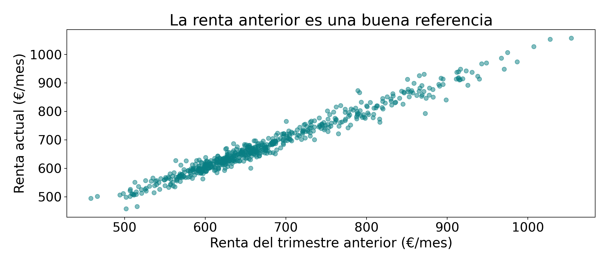
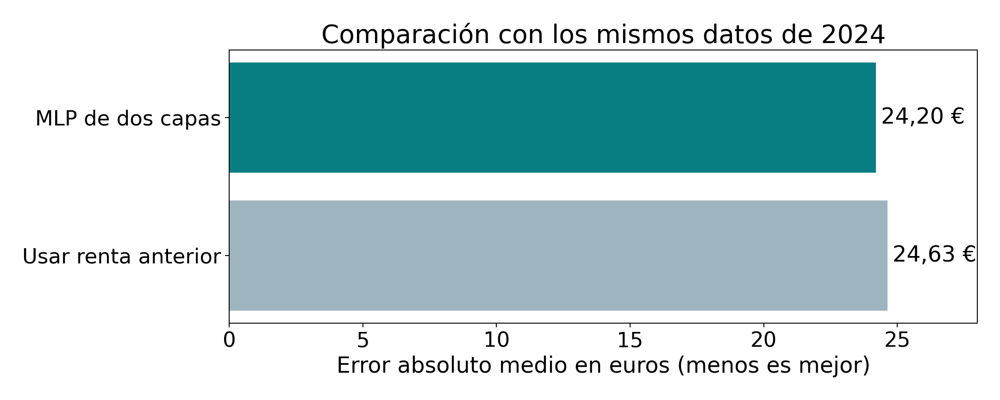
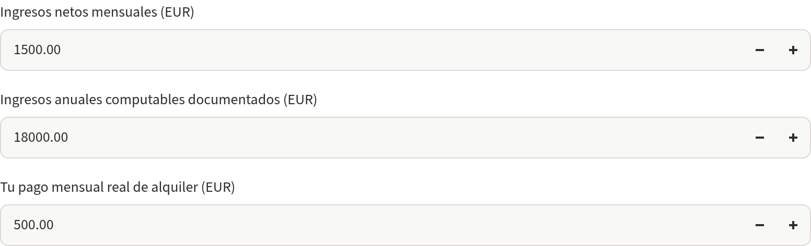
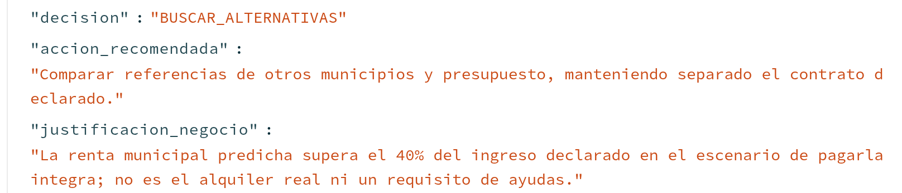

# Presentación SAA PIA y MIA

## 1 Una referencia para orientar

Hemos creado una aplicación que estima el alquiler medio de un municipio y ayuda a explicar qué supone para una persona.

:::flow Estimar alquiler | Comparar con ingresos | Orientar | Guardar una ficha

La orientación se puede revisar y explicar.

## 2 Aprendemos de la evolución del alquiler

:::cards 768 :: Observaciones de EMAL en total. | 19 :: Municipios representados en los datos. | Una fila :: Un municipio en un trimestre; no un piso.

Elegimos estas estadísticas porque permiten estudiar cómo cambia la renta media a lo largo del tiempo.

## 3 Primero miramos los datos

La renta de un trimestre se parece mucho a la anterior. Por eso usamos la anterior como referencia sencilla con la que comparar.

## 4 Comprobamos sin mirar el futuro

:::flow 601 para aprender | 75 para comparar | 92 para la prueba final

Ordenamos los datos por fecha y preparamos las variables siempre de la misma forma.

Así evitamos ayudar al modelo con información que todavía no tendría al predecir.

## 5 Probamos y guardamos la comparación

:::cards 5 familias :: Lineal, KNN, Random Forest, XGBoost y SVM. | 4 redes MLP :: Una base y tres variantes para comparar cambios. | 1 criterio :: El error en euros sobre los datos de validación.

Registramos los resultados en MLflow para poder justificar qué modelo conservamos.

## 6 Elegimos el menor error

La MLP de dos capas mejora unos 0,43 €. Es una mejora pequeña frente a usar directamente la renta anterior.

## 7 Miramos qué pesa en la predicción

SHAP ayuda a explicar el modelo. En la prueba final, el error absoluto medio fue de 28,67 €; no es un margen garantizado para cada caso.

## 8 Probamos un caso inventado en la app

Bilbao: ingreso de 1.500 € y alquiler de 500 €. Sin deudas, el alquiler supone el 33,33 % del ingreso.

## 9 Explicamos por qué orientamos así

Las diez reglas tienen prioridad. En este caso, la referencia supera el 40 % del ingreso y propone comparar municipios. El sueldo se usa después de predecir.

## 10 Pedimos permiso antes de guardar

:::flow Consentimiento | n8n recibe la decisión | Crea la ficha | Confirma el guardado

Según la orientación, generamos una ficha de alternativas, un plan o una lista de comprobación.

La acción es local: no tramita ayudas ni envía mensajes reales.

## 11 Comprobamos que la acción queda guardada

:::cards Primer envío :: Se crea una ficha para esa orientación. | Mismo envío :: Se conserva una sola ficha. | Si falla :: La app avisa y no confirma el guardado.

En la demostración abrimos la ficha y comprobamos el resultado. Compartimos la decisión y la referencia, sin enviar el sueldo.

## 12 Qué hemos conseguido y qué mejoraríamos

:::cards Conseguido :: Referencia, explicación y acción comprobable. | Límite :: Mejora pequeña y cobertura de 19 municipios. | Siguiente paso :: Actualizar datos y explicar mejor la incertidumbre.

El resultado sirve como orientación sobre rentas municipales, no como precio exacto de un piso.
